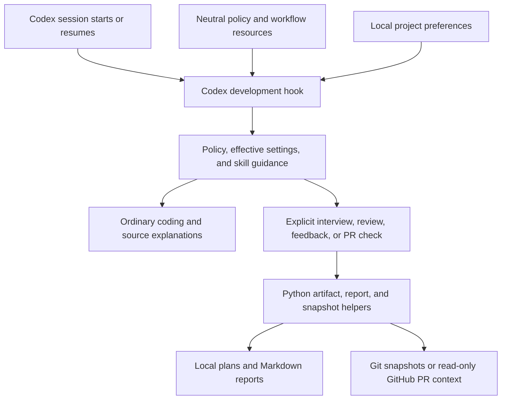

# Mentor

**A coaching layer for AI coding agents that keeps developers involved in understanding, building, and reviewing software.**

Coding agents can finish a task while leaving the developer with little understanding
of the result. Mentor makes that collaboration explicit: choose the kind of coaching
you want, decide who writes the code, and work through decisions and verification
with the agent. Readable code, useful comments, and accurate documentation remain
part of the task at every level.

Mentor combines a host-neutral policy and workflow core with Python helpers for
preferences, artifacts, and reports. Its first adapter integrates with Codex through
native development hooks and explicitly invoked skills.

**Status:** Private-use prototype with implemented workflows, a native local Codex
plugin package, and recorded verification. Public distribution remains planned.
The core is designed to be independent of coding language, model, and host; current
evidence covers selected Codex/OpenAI runs with C# and Python, not universal support.

## What using it looks like

After configuring Mentor, you can ask naturally:

> Use Junior coaching and manual coding for this conversation. Help me add a
> monthly expense summary. Start by explaining the existing calculation and give
> me a focused first step.

Mentor's intended behavior is to inspect the actual source, explain the relevant
flow, and offer progressive hints while you write the implementation. Ask for a
demonstration of a particular part when needed; that scoped exception ends with a
return to manual guidance. Checks and review assess the resulting code.

For more structure, explicitly invoke a workflow. These examples use the private
plugin identifiers; development registrations use the bare `$mentor-interview`,
`$mentor-review`, `$mentor-feedback`, and `$mentor-pr-check` names:

| Workflow | Example | Result |
| --- | --- | --- |
| Define a task | `$mentor:mentor-interview Help scope the expense summary; requirements only.` | Focused clarification, a confirmed plan, and local interview/plan files. Implementation requires an implementation request. |
| Practice review | `$mentor:mentor-review Review staged changes; run relevant checks.` | A review primer and pause for your observations, followed by evidence-backed findings and a local report. Fixing or posting requires a separate request. |
| Get task feedback | `$mentor:mentor-feedback Give feedback on this task.` | Immediate, grounded feedback and a local report; reflection is optional. |
| Check PR understanding | `$mentor:mentor-pr-check https://github.com/OWNER/REPO/pull/NUMBER` | Source-grounded questions with hints, explanations, skip/stop controls, and a local report. |

Ordinary coding help and explanations of existing source need no special skill,
PR, quiz, or report. Full workflows run only when explicitly invoked.

## Choose coaching and coding ownership separately

| Profile | Coaching focus | Default participation |
| --- | --- | --- |
| **Junior** | Code understanding, safe changes, debugging, tests, and review. | Offers a focused coding contribution. |
| **Mid-level** | Feature ownership, design, contracts, failure handling, and verification. | Offers coding or reviewing. |
| **Senior** | Engineering judgment, tradeoffs, reliability, and change risks. | Agent implements with developer direction and review. |

**Manual coding** means you write the code while the agent guides and reviews. It
avoids implementation edits and complete solutions unless you explicitly request
that part. **Assisted coding** uses the selected profile and your task-specific
agreements to allocate the work. Coding ownership is independent of profile and
remains in effect when coaching is paused.

Controls use ordinary language:

- “Use Mid-level” or “use manual coding” changes this conversation.
- “Save manual coding for this project” explicitly persists a project preference.
- “Pause coaching” keeps code standards and necessary checks active.
- “Show Mentor status” displays effective and saved choices.
- “Use project preferences again” removes session overrides.

Levels stay manually selected. Mentor does not grade proficiency, automatically
promote developers, or maintain a background learner ledger. Manual mode is an
agent instruction, not a filesystem permission lock.

## How it works



1. **Deliver context through the host.** The Codex `SessionStart` handler loads
   the canonical policy, refreshes project defaults, and supplies session controls
   and concise skill guidance. Full workflow instructions load on invocation.
   Missing core resources fail visibly; preference failures retain valid policy
   with a warning.
2. **Resolve preferences without implicit writes.** Session overrides take
   precedence over saved project defaults. The neutral runtime identifies Git
   projects by their canonical common directory, so linked worktrees share
   settings. Reads do not create or migrate records; explicit project changes
   use atomic writes and readback. Failed saves remain visible as unsaved session
   choices.
3. **Ground review in a specific revision.** The adapter captures local Git
   content or reads PR source through GitHub CLI. Snapshots include content
   identities; refreshing after a pause detects changes that invalidate affected
   evidence. Checks must match the reviewed snapshot.
4. **Keep task artifacts local.** Plans and Markdown reports live outside the
   repository under `<user-home>/.mentor` by default, with an optional
   `MENTOR_DATA_DIR` override. Reports use exclusive publication and readback to
   avoid overwriting an existing report. Storage failures are reported explicitly.

The core contains no host hook schema or model API integration. Those concerns
belong in adapters. The Python runtime uses the standard library; Python is an
implementation choice for the helpers, not a restriction on the developer's
project language. Optional Serena integration provides semantic source navigation
with ordinary-tool fallback. Optional Prism integration supplies project context
using separate Mentor storage by default; neither service is required. See the
[MCP setup guide](adapters/codex/MCP-SETUP.md).

## Try it locally

For private plugin setup, follow [install, update, disable, and remove instructions](docs/PRIVATE-INSTALL.md).
The tested package uses Python 3.11+, Git, a POSIX shell, and a Codex host supporting
the recorded hook/skill interfaces. C# fixture
execution additionally needs its .NET SDK; PR access uses authenticated GitHub CLI.
Serena is optional.

From the Mentor checkout, run the process-boundary checks:

```sh
python3 -m unittest discover -s tests -v
```

For development without the plugin, follow the [Codex adapter guide](adapters/codex/README.md) to create a disposable
workspace, generate its `.codex/hooks.json`, review/trust the hook through the host,
and register the native skills. The hook does not register skills by itself.
Moving the development checkout requires updating the generated paths and skill
links. Avoid enabling both development registration and the installed plugin in
the same workspace.

Use the [C# fixture](fixtures/expense-summary/README.md) or
[Python fixture](fixtures/expense-summary-python/README.md) to evaluate a completed
candidate. The checked-in starters are intentionally unfinished; their behavior
checks are expected to fail until implemented. Supplying policy manually tests
core behavior, but does not prove automatic hook delivery.

## Verification and limits

Verification separates runtime correctness, host delivery, agent conduct, generated
software, and human understanding:

| Area | Recorded evidence | Boundary |
| --- | --- | --- |
| Runtime and adapter contracts | The private-package revision records 36 passing tests covering helpers, persistence, lifecycle handlers, wrappers, optional MCP setup, and native package lifecycle. | Process tests do not prove model compliance. [Package evidence](docs/evidence/private-plugin.md), [manual-mode evidence](docs/evidence/manual-coding-mode.md). |
| Native host integration | Recorded startup/resume/clear/manual-compaction checks, native skill discovery, and selected workflow/control conversations. | Historical baseline: Codex CLI/app-server 0.160.1, macOS arm64, OpenAI `gpt-6.1-sol`, C#/.NET 9. Versions and scope belong to each receipt. [M01](docs/evidence/M01.md), [M02](docs/evidence/M02.md). |
| Generated code and workflow conduct | C#/Python behavior checks, code/comments/docs review, selected native review/feedback/PR-check runs, and disposable project trials. | Scripted participation is labeled separately from human participation. [Combined evidence](docs/evidence/M04-M07.md), [acceptance audit](docs/evidence/M04-M07-acceptance.md). |
| Private package | Native install/update/disable/remove and app-server skill/hook discovery in a disposable host home. | Trusted automatic delivery and live manual-mode conduct remain pending for this revision. [Package evidence](docs/evidence/private-plugin.md). |
| Manual coding ownership | Persistence, precedence, migration, and handler/wrapper transport checks. | Fresh native model compliance with the new manual mode remains unobserved in that revision. [Evidence](docs/evidence/manual-coding-mode.md). |

These checks do not establish improved learning outcomes or universal code-quality
improvement. The initial baseline already passed its behavior checks. Human
understanding, broader provider/host compatibility, and automatic mid-turn
compaction remain pending. See the evidence for observed hook conflicts and
other limitations. Distribution is the final phase of the [roadmap](docs/ROADMAP.md).

## Explore the repository

| Path | Responsibility |
| --- | --- |
| [`core/`](core/policy.md) | Neutral code-quality policy and coaching workflows. |
| [`runtime/`](runtime/README.md) | Project identity, preferences, interview artifacts, and report storage. |
| [`adapters/codex/`](adapters/codex/README.md) | Host hooks, controls, native skill wrappers, local/PR snapshots, and optional Serena setup. |
| [`fixtures/`](fixtures/expense-summary/README.md) | Small C# and Python tasks with independent behavior checks. |
| [`tests/`](tests/) | Runtime and adapter contract checks. |
| [`docs/evidence/`](docs/evidence/) | Recorded experiments, acceptance checks, and limitations. |

For the product contracts and development direction, see the
[design](docs/DESIGN.md), [implementation plan](docs/IMPLEMENTATION-PLAN.md),
[testing criteria](docs/TESTING.md), and [current local-product handoff](docs/handoffs/M04-M07-local-product.md).
[Attribution](docs/ATTRIBUTION.md) records authorship, design inspiration, and
upstream references.
