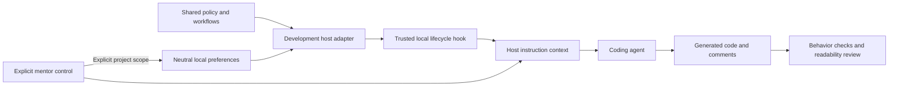

# Mentor implementation plan

Status: M04–M07 implementation performed on 2026-10-07 with passing local
boundary/fixture checks and [recorded verification limits](evidence/M04-M07.md).
Selected native conduct, direct/host Serena calls and the disposable pinned-SDK
build/HTTP checks passed; full verification remains incomplete. M01–M03 evidence remains the historical verified baseline.
Scope: one continuous local-product delivery, with checks after each component.
M08 packaging/publication stays separate. Implementation was explicitly requested.
Workflow coexistence and optional Prism reuse (§7a) are a planned addition to the
ongoing PR; implementation and host verification for that addition remain pending.

## M04–M07 execution plan

Implement the tasks below in order. Each task specifies its outputs and verification;
keep component results distinct within the combined delivery. The primary agent
handles the workflows. Use existing OpenAI access, with other providers pending.

| Task | Implementation outputs | Depends on | Verification before advancing |
| --- | --- | --- | --- |
| 1 | Read baseline/contracts and retain current working changes | M01–M03 | Scope/status/reference check |
| 2 | Update core assistance and Junior/Mid-level/Senior profiles; migrate level controls/preferences | 1 | Profile-specific conduct, legacy-state compatibility and actual generated code/comments/docs |
| 3 | Add `runtime/reports.py` and `tests/test_reports.py` | 1 | Isolation, collisions, preservation, wrong-project paths and real write failures |
| 4 | Add `adapters/codex/review_target.py` and `tests/test_review_target.py` | 1 | Explicit local/PR scope, index/worktree differences, dirty identity and revision/access errors |
| 5 | Add `core/workflows/review.md` | 2–4 | S04 defect, target clarification, primers/pause/skip and evidence accuracy |
| 6 | Add `core/workflows/feedback.md` and `pr-understanding.md` | 2–4 | Immediate feedback; grounded questions/answers, hint/skip/stop and report-only behavior |
| 7 | Add three native skill wrappers and `adapters/codex/reports.py`; update hook guidance | 3–6 | Native discovery/invocation, ordinary-task control, session overrides and resource failures |
| 7a | Preserve existing Workflow integration and document optional Prism reuse in the Codex adapter | 7 | Actual host coexistence, one reused Prism connection, project isolation and standalone/failure fallback |
| 8 | Add `adapters/codex/serena/` setup/launch/examples/README | 2, 7 | Real connection reuse/activation/navigation and no-server fallback |
| 9 | Add independent Python fixture and run combined verification | 2–8 | Behavior/code-quality checks, workflow/host matrix and bounded tool comparison |
| 10 | Build a DoughTracker slice in a disposable copy | 2, 7, 9 | Generated behavior/help, readable code/comments/docs, completed-slice checks and unchanged original project |
| 11 | Explain existing Stafr/Crew Workforce backend behavior | 2, 7, 9 | Source-grounded responsibilities/flow, locations and accurate check limits |

Unavailable optional-tool, provider or human observations remain pending. Verified
local functionality can be used without claiming those observations passed.

### Product behavior

Mentor supports two core uses through ordinary help:

- **Create a project:** establish a small useful behavior, explain consequential
  code and decisions, offer a meaningful coding contribution with context, help
  with the accepted attempt, complete surrounding implementation and verify the
  combined result. Generate readable names/flow, useful comments and accurate docs.
- **Understand an existing project:** inspect real source, requirements and tests;
  explain service/module responsibilities and trace selected behavior with concrete
  file/symbol references. Include inputs, control/data flow, boundaries/failure
  behavior and what checks do or do not establish. No diff or PR is required.

Readable code, useful comments in the resulting code, and accurate documentation
are the foundation at every level, including paused coaching. Comments explain
intent, constraints and non-obvious rules; chat explanations do not replace them.

Adjust support to manually selected Junior/Mid-level/Senior profiles. Honor the
learner's requested coding participation without changing preferences. Direct help,
examples, skips and takeover remain available. Ordinary help requires no full skill,
compulsory quiz/report or learner ledger. Explicit review, feedback and self-check
workflows have their own invocation/recording contracts.

### Manual mentoring profiles

| Profile | Default focus | Observable Mentor behavior |
| --- | --- | --- |
| Junior | Code comprehension, safe changes, debugging, tests and reviews; introductory system design | Trace execution/data flow, explain concepts with concrete examples, introduce component responsibilities, and offer a small meaningful coding contribution with context and progressive help. |
| Mid-level | Complete feature ownership, system design, API/data contracts, failure handling, refactoring and verification | Invite an approach, examine responsibility boundaries and alternatives, connect components and failure paths, and help choose meaningful checks. Offer coding or reviewing. |
| Senior | Engineering judgment under ambiguity, architectural tradeoffs, reliability, change risks, simplicity and technical communication | Examine assumptions and missing requirements, compare options against actual constraints/evidence, assess migration/operational consequences, and help communicate decisions or review feedback. Default to agent implementation with learner direction/review. |

Select concerns relevant to the current task; do not turn a small change into an
architecture exercise or assume speculative scale requirements. These profiles
set coaching priorities, not assessed proficiency. Manual selection remains local
to the session unless project scope is explicit. Help on any topic, examples,
direct explanation and takeover remain available at every level. Coding ownership
is separate from coaching focus; explicit requests and project agreements override
participation defaults. Pausing coaching retains the same code/comment/doc standards
and necessary checks.

### Scope and delivery

One sustained M04–M07 implementation, with internal verification after each
component. Reuse working M01–M03 policy, preferences, interview and host integration.
Primary agent executes workflows. Packaging/publication remains M08.

Use existing OpenAI access. Add a standalone Python coding fixture alongside C#;
this does not set the learner's language. Additional providers remain unverified
and pending, with no new paid accounts required. Unavailable external observations
stay pending while verified local functionality can be used. Milestone completion
claims follow actual evidence, not the combined delivery label.

### 1. Repository baseline and planning references

Use this section as the active combined technical plan. It carries the newer M05
Serena and M06 PR-self-check contracts alongside the confirmed M04 evidence, target
clarification and focused-check decisions. Preserve existing working changes,
historical evidence and upstream attribution. Keep README.md, docs/ROADMAP.md,
docs/IMPLEMENTATION-PLAN.md, docs/DESIGN.md, docs/TESTING.md and the component
handoffs aligned as implementation proceeds.

Keep M04–M07 IDs as traceable criteria/checkpoints within this delivery. Do not
introduce a new planning interview or blanket approval gate between components.
M05's unavailable cross-provider checks do not gate implementing M06. M07
observation is recorded during real use.

### 2. Core support for creation and understanding

Update core/policy.md and the applicable neutral guidance to explicitly cover both
core uses and the manual profiles above. Keep always-loaded guidance concise and
independent of target language, LLM/provider and host. Preserve control scope,
session overrides, pause/resume and project isolation while changing level values.

Update `core/workflows/controls.md`, `core/workflows/interview.md`,
`runtime/preferences.py`, `adapters/codex/control.py`,
`adapters/codex/session_start.py` and the existing native interview context/usage
where needed. Use canonical values `junior`, `mid-level`, `senior`, with Junior/on
as the initial/reset fallback. Preserve legacy manual selections by translating
`guided` to `junior`, `supported` to `mid-level`, and `independent` to `senior`.
Accept legacy control names as compatibility aliases; report canonical names.

Read valid schema-version-1 project records and retained legacy session values
without writing or clearing overrides. Save canonical values in schema version 2
only on an explicit project write/reset; preserve the other saved field. Validate
version-specific enums and coaching types; unknown values/versions still warn and
leave the original record intact. Status must identify translated legacy values
and distinguish effective/saved state; never claim an unwritten migration was saved.
Keep existing atomic-save/readback and failed-write semantics.

Extend relevant preference/adapter/interview boundary checks for legacy reads,
session override retention, explicit version-2 writes, aliases, invalid records,
reset/failure recovery and two-session refresh. Recheck native startup, resume,
manual compaction, clear, controls and interview invocation using the new values.
Historical M02/M03 evidence remains evidence for the legacy implementation.

For new work, agree the contribution before leaving a learner task unfinished.
Provide surrounding context, progressive help and a complete verified result on
request. For existing code, select a useful flow and inspect actual implementation;
label unexplored modules, missing source and untested behavior. Direct explanation
requests receive explanations without an answer prerequisite. No extra walkthrough
skill is required. Do not edit an existing project simply to explain it.

Verify fresh ordinary creation and explanation conversations, with no implicit
full-skill activation or preference/artifact writes. Inspect actual generated code,
comments and docs; policy text and chat explanations alone do not prove quality.

### 3. Shared neutral report storage

Add runtime/reports.py for the three new report workflows. Reuse validated explicit
data-root/project identity handling. Use task-specific directories under the neutral
project data root, using these task-specific locations:

| Kind | Directory under `<data-root>/projects/<project-id>/` | Report |
| --- | --- | --- |
| Review | `reviews/<date>-<task-slug>/` | `review.md` |
| Feedback | `feedback/<date>-<task-slug>/` | `feedback.md` |
| PR self-check | `pr-checks/<date>-<task-slug>/` | `pr-check.md` |

Use only the supported categories; do not accept arbitrary path prefixes.
Reserve directories exclusively, use collision suffixes, restrict paths to the
resolved project, preserve prior reports and publish/read back complete Markdown.
Expose invalid locations, unavailable storage and failed/partial writes accurately.
Never select a fallback root or claim saved output without verification.

Keep M03 InterviewArtifacts intact; reports do not acquire interview-confirmation
semantics. Store only workflow-specific evidence/content. Review/feedback do not
store full learner transcripts; explicit PR self-check records only actual relevant
questions, answers and assistance. No profile, automatic scoring, background ledger
or preference mutation. Avoid a generalized evidence-ingestion framework.

Implement a neutral `ReportStore` with an explicit data root, project ID and one
supported report kind. Expose `create(task)` to reserve a new task directory and
`save(directory, markdown)` to write/read back that kind's report. Validate nonempty
labels/content and this project's reserved directory; a save never silently replaces
an existing final report. Keep snapshot/evidence interpretation in the workflow.

Expose these operations through `adapters/codex/reports.py` with explicit
`--project-id`, `--data-root` and `--kind review|feedback|pr-check`, followed by
`create --task LABEL` or `save --directory PATH` with Markdown on stdin. A successful
result identifies the saved path and verified persistence; an error exits nonzero
without a success claim. Use quoted arguments/stdin for Markdown.

Add `tests/test_reports.py` through actual helper/adapter entry points for isolation,
collisions, wrong-project/invalid paths, previous-report preservation and real
write failures. Keep `runtime/artifacts.py` and existing interview tests unchanged
unless an integration change actually requires a regression check.

### 4. Shared adapter target/snapshot access

Add adapters/codex/review_target.py for agreed local Git scopes and GitHub PRs;
reuse it for M04 review and M06 PR understanding. Host transport/schemas stay in
the adapter, not the neutral core/runtime. Ordinary existing-project explanations
can inspect source directly and do not require this diff-based entry point.

If a review target is missing, ask what to review; reuse clear supplied targets.
Capture base/HEAD, included staged/unstaged/untracked content and a digest/equivalent
identity, including relevant modes and deletions/renames. For PRs record repository,
URL, base/head and inspected surrounding code. Preserve argument boundaries for
paths/refs. Unavailable tools/access/context fail visibly without invented evidence.

Use disposable checkouts/copies for checks where needed. Verify exact checked
content: staged-only review cannot reuse a result from different unstaged content.
Recapture identity at finalization, refresh changed scope and label stale results.
Keep the user's source checkout and PR state intact. Return structured target
metadata: target kind, resolved repository/workspace, requested scope, base/head,
included paths, snapshot identity and inspected diff/context references. For PRs,
include URL and repository identity. The snapshot identity covers selected content,
relevant modes, deletions and index/worktree/untracked distinctions; it is not merely
HEAD. Record which snapshot was used for each executed check.

Add `tests/test_review_target.py` using real temporary Git repositories for local
scope/content capture and staged/worktree distinctions. Cover PR transport/revision
failures through adapter boundaries; prove successful live retrieval separately in
the actual native-host scenario. Do not label simulated transport a live PR check.

### 5. Explicit M04 review

Add core/workflows/review.md and an explicit-only Codex mentor-review wrapper.
Follow the confirmed M04 handoff: resolve target; inspect code/context and evidence;
select relevant concerns; prime at the manual level; pause for supplied observations
or a findings request; discuss evidence; save report; finish at findings.

Junior supplies a code-flow walkthrough and concrete correctness/test examples;
Mid-level supplies prompts about boundaries, contracts and feature failure paths;
Senior supplies a concise primer about assumptions, tradeoffs and change risks.
Every profile still inspects correctness, readability, comments and docs and reports
all identified material findings. Direct-findings and coaching-off bypass the practice pause.
Disclose serious defects immediately and report all identified material defects.
Silence does not constitute an attempted review. Update affected context/primer
when a target changes during the pause. No fixes, posting or repair-skill dispatch.

Run relevant focused existing checks when practical. Record command/result,
covered behavior, snapshot/configuration and evidence references. Inspect supplied
results. Separate reproduced defects, required verification gaps, optional polish
and learning discussion. Stale/unrelated/unknown-provenance results do not establish
a current PASS. Non-UI work acquires no screenshot or upstream-pack requirement.

### 6. Explicit M06 feedback and PR understanding

Add core/workflows/feedback.md and a native explicit-only mentor-feedback wrapper.
Reuse the current task and available evidence, including work in progress. Provide
concrete strengths, improvements and an optional next step immediately; reflection
is optional. Save scope/evidence/checks/limitations without learner grading, fixes,
posting, preference writes or automatic full interview/review invocation.
Use the manual profile's task-relevant focus for feedback and questions: code flow
and safe changes for Junior; connected design/contracts and verification for
Mid-level; assumptions, alternatives and consequences for Senior. Give deeper
explanations on request at every level without changing preferences.

Add core/workflows/pr-understanding.md and a native explicit-only mentor-pr-check
wrapper for a supplied GitHub PR. Read real diff/context/tests, prepare useful
code-backed questions, wait for answers before explanations unless help/skip is
requested, accept equivalent valid reasoning and record actual assistance.
Correct, mistaken, assisted and unattempted responses remain distinct. Honor hint,
explanation, skip and stop. Coaching-paused explicit invocation runs the requested
self-check without resuming coaching. Refresh changed PR evidence/questions or
state the recorded revision limit. Serious defects are disclosed immediately.
No automatic code/PR edits, approval/merge, ability grades or mastery claims.

### 7. Native wrappers and hook integration

Each new adapters/codex/skills/<name>/ wrapper includes SKILL.md,
agents/openai.yaml and a thin context entry. Share context/report code only where
it removes real duplication. Resolve the actual development checkout/resources,
current learner workspace, pinned data root and current M02 session object.
Refresh saved defaults read-only and preserve session overrides. Disable implicit
invocation through native metadata. Expose usable shell-quoted adapter commands.

Add adapters/codex/reports.py as the thin report entry point, plus concise invocation
guidance/resource validation in adapters/codex/session_start.py. Full workflows
load only on invocation, keeping
the existing hook context bounded. Verify actual development-host discovery/loading
in external workspaces, relocation/another cwd, missing resources, unchanged
preferences and ordinary-task negative controls. Verify deliberate waits under
current installed hooks; report conflicts without patching private toolkit files.

### 7a. Existing Workflow coexistence and optional Prism reuse

Mentor must work alongside an installed Agentic Workflow; removing Workflow is
not a prerequisite. Keep Mentor's hook entries and explicitly invoked skills
distinct, preserving existing host hooks, MCP registrations and settings. Verify
ordinary help, explicit Mentor invocation and deliberate learner waits under the
actual installed hooks. Investigate conflicts before proposing a minimal adapter
or configuration change; do not patch private toolkit code or introduce new time
limits as a workaround.

Offer opt-in reuse of a compatible Prism MCP connection already exposed by the
host. Inspect its actual registration/version and verify available tools instead
of hardcoding a personal path or port. Do not start a second Prism server or
overwrite an existing registration. Keep this support in the Codex adapter with
repository-owned usage guidance; Prism and Workflow are optional integrations,
not core dependencies. Absent, incompatible, disabled or failing Prism must leave
ordinary Mentor help and explicit workflows usable with a clear fallback.

Use Prism only for project context, such as decisions and handoff notes, with
explicit opt-in and explicit requests to save. Respect project boundaries and
identify retrieved context's source; stale notes cannot override current
instructions or source evidence. Do not store learner transcripts, proficiency
grades or a background learner ledger. Manually selected levels, per-project
preferences and local Markdown reports remain authoritative in Mentor's neutral
local storage; Prism does not infer levels or change coaching/code ownership.

Verification: record actual development-host hook delivery and explicit skill
invocation with Workflow retained, unchanged existing registrations/settings,
and reuse without a duplicate Prism process/registration. Exercise project-context
retrieval and an explicitly requested save/readback, project isolation, unchanged
Mentor preferences, no implicit writes, and standalone/unavailable-tool fallback.
Record tested host/tool versions and pending observations; standalone Prism startup
does not establish Mentor integration. This section adds scope to the plan only;
it does not authorize implementation or claim these checks have passed.

### 8. Optional Serena setup and navigation

Add repository-owned opt-in setup/launch helpers, configuration examples and README
under adapters/codex/serena/. Inspect the actual installed version and current
supported tool/configuration options during implementation. Reuse a compatible
existing host connection; provide local setup when absent without duplicate
registration or silent configuration overwrite. The existing Docker registration
is a candidate for reuse, not proof of live tools or a required private launcher.

Support explicit project activation and read-only definitions/references/structure
navigation. Keep ordinary rg, full file reads, diffs, edits and checks available.
Disable memory/onboarding features for this integration. Absent/incompatible/failing
Serena falls back visibly without blocking ordinary Mentor use or inventing tool
results. Tool availability changes no level, ownership agreement or skill activation.

Verify real host activation and semantic calls, another cwd/worktree and no-server
fallback. Compare the same bounded task with/without Serena using the same model,
settings, starter and requirements; record available calls/time/tokens and actual
code quality, including startup overhead and absent metrics. Add no full runner or
new paid model accounts to obtain comparison evidence.

### 9. Immediate checks and portability evidence

Use the development-time testAudit authoring gate when writing tests. Run focused
boundary checks and python3 -m unittest discover -s tests -v after affected executable
portions. Existing expense fixture checks own their public behavior; add an equivalent
standalone Python fixture with independent behavior checks. Language choice is test
coverage only. Maintain a truthful language/model/host/Serena matrix.

Exercise both ordinary core uses and all explicitly invoked workflows. Cover
manual levels, session overrides, coaching-off, accepted contributions/direct help,
S04's boundary defect and optional polish, PR retrieval, answer/hint/skip/stop,
changes during waits, missing/stale/unrelated evidence, report/resource failures,
collisions and ordinary-task controls. Observe native delivery separately from
scripted behavior. A review's correctly reproduced defect can produce a failing
check without requiring a fix. Inspect resulting code/comments/docs directly.

Use existing OpenAI access; mark cross-provider compatibility pending. Record actual
model/runtime versions and bounded observations, with no universal compatibility,
efficiency or human-learning claim. Automate only useful checks, outside a compulsory
full evaluation runner.

### 10. M07 trial: create DoughTracker's backend

Prepare and document a Mentor-supported backend-rebuild session against DoughTracker's
current project contracts. Run the entire build trial in a disposable copy containing
the relevant source and local docs. Preserve the original checkout, uncommitted work
and project data. Generated code changes belong only to the trial copy and are never
applied, committed or promoted to DoughTracker.

Use one small backend behavior selected from its active rebuild handoff.
Explain the request-to-response flow; prepare a meaningful learner contribution with
context; respect the user's request to do a little coding; complete and verify the
surrounding result. Assess generated names/flow, intent/rule comments and docs.
Run builds, tests and any local startup checks using trial-local configuration and
resources. Inspect the completed result before discarding the trial code, generated
outputs and trial resources. Retain evaluation notes and check results, rather than
a persistent implementation or patch. Verify that DoughTracker's original files,
Git state and project resources match their pre-trial state.

Record actual authored work, assistance, checks and supplied observations. A scripted
preflight is labeled simulation; human participation/understanding stays pending
until it is observed. A disposable trial still exercises actual generated code and
checks. Evaluate whether Mentor builds understandable, working code on this slice;
completion of the entire backend or an observed learning outcome is not required.

### 11. M07 trial: understand Stafr/Crew Workforce

Use the existing crew-workforce repository as the read-only source trial. Read its
project/service instructions and relevant docs, then inspect actual code/tests.
Map major backend responsibilities and trace one concrete request through selected
configuration/runtime/tool/data boundaries, with file/symbol references. Start from
a real implemented flow; do not infer behavior from architecture documents alone.

Explain inputs, state/data movement, errors, external boundaries and relevant checks.
Use a diagram when it clarifies the flow. Expand to another flow as requested,
labeling inspected scope and unknowns. Ordinary explanations have no PR/diff, quiz,
special skill or report prerequisite. Optional review/feedback/self-check runs retain
their distinct explicit contracts. Run relevant checks only in disposable copies
when needed; preserve source/service state and use no production credentials.
Record actual user observations if supplied, without scores or fabricated learning.

### Documentation and completion

The planned implementation files are:

| Area | Files |
| --- | --- |
| Ordinary assistance | `core/policy.md` and any necessary neutral guidance |
| Manual profiles and compatibility | `runtime/preferences.py`, `core/workflows/controls.md`, `core/workflows/interview.md`, Codex control/hook/interview context and existing preference/adapter/interview checks |
| Three workflows | `core/workflows/review.md`, `feedback.md`, `pr-understanding.md` |
| Report storage | `runtime/reports.py`, `adapters/codex/reports.py` |
| Targets/snapshots | `adapters/codex/review_target.py` |
| Native skill wrappers | `adapters/codex/skills/mentor-review/`, `mentor-feedback/`, `mentor-pr-check/` |
| Hook guidance | `adapters/codex/session_start.py` |
| Opt-in tools | `adapters/codex/serena/` helpers, examples and README |
| Independent second fixture | `fixtures/expense-summary-python/` |
| Boundary checks | Focused report/target/native-wrapper checks under `tests/` |
| Evidence and usage | `docs/evidence/M04.md` through `M07.md`, runtime/adapter READMEs |

The runtime paths above are implemented; evidence/usage documents record actual results.
The additional Workflow/Prism adapter guidance and integration in §7a remain planned.
Update runtime/README.md and adapters/codex/README.md with actual controls, skill
invocation, report locations, setup/fallback and creation/existing-code examples.
Add implementation evidence reports after running checks and trials, linking actual
revisions/snapshots and receipts. Keep raw interviews/transcripts outside public Git
and local private project paths out of reusable core/adapter code. Append inspected
source attribution; author original material unless copying terms are verified.

A usable local build requires working core help, three explicit native workflows,
truthful snapshot/report handling, preserved preferences, real applicable host/check
results and visible optional-tool fallback. Mark unavailable Serena/provider/human
observations pending rather than assigning a milestone PASS. Track M04–M07 separately
for evidence within this one delivery. M08 packaging/publication remains excluded.

### Acceptance criteria

Local boundary/fixture results are recorded in [evidence](evidence/M04-M07.md).
Unchecked rows retain newly planned, unauthorized integration scope. Check against applicable T criteria in
[TESTING.md](TESTING.md#criteria); documentation completion is not runtime completion.

- [x] Ordinary new-project work supports the agreed small learner contribution,
  useful direct help/takeover and a complete checked result at the manual level.
- [x] Ordinary existing-project help explains actual source behavior with locations,
  traced flow and check limits, without a diff/PR or full-skill prerequisite.
- [x] Generated implementation, names, comments and documentation satisfy T04;
  native policy delivery and prose alone do not establish code quality.
- [x] Junior, Mid-level and Senior demonstrate their task-relevant focus, with
  readable code/useful comments/docs and direct help available at all levels and
  during paused coaching. Coding ownership remains independently overridable.
- [x] Legacy saved/session levels translate read-only; explicit project writes use
  schema version 2. Controls, overrides, lifecycle, isolation and save failures
  retain their contracts; native evidence for new profiles is recorded separately.
- [x] Review, feedback and PR self-check load through actual native explicit
  invocation and retain their distinct pause/help/report-only contracts.
- [x] Target resolution, snapshot identity and focused check results support the
  reported scope. Stale/unknown evidence and verification gaps remain accurate.
- [x] Shared reports preserve earlier records, isolate projects and expose storage
  failures. Effective/saved preferences remain unchanged on these workflows.
- [x] Repository-owned Serena setup/reuse and fallback are exercised; actual semantic
  use is claimed only with host evidence. Efficiency metrics stay evidence-based.
- [ ] Mentor works with Workflow retained and standalone. Optional Prism reuses one
  existing connection without overwriting host setup; actual host delivery,
  project-context isolation, explicit saves, unchanged preferences and unavailable
  fallback are verified. No learner tracking or implicit writes are introduced.
  This row includes the §7a planning addition and remains outside the original
  implementation authorization; original installed-hook observations are recorded separately.
- [x] C# and Python results identify the exercised OpenAI model/host combination.
  Cross-provider coverage is explicitly pending and requires no new paid account.
- [x] DoughTracker creation and Stafr understanding trials record actual inspected
  code, authored work, checks and supplied observations. Simulation and pending human
  participation are separate from observed comprehension.
- [x] DoughTracker trial code exists only in a disposable copy and is discarded after
  evaluation. Retained notes/check results contain no implementation to apply. The
  original checkout, uncommitted work, Git state and project resources stay unchanged.
- [x] Usage/status/attribution and evidence reports match real results. Packaging
  and publication remain the final M08 phase.

See [verification criteria](TESTING.md#criteria), the
[combined verification matrix](TESTING.md#m04m07-combined-verification), and
[component roadmap](ROADMAP.md#combined-local-product-delivery--m04m07).

## Existing baseline and first-release contracts

The sections below retain the baseline contracts and earlier planning context.
Use the [execution plan above](#m04m07-execution-plan) for the current task order.

Status: Revised on 2026-10-06 for language/LLM neutrality, distribution last,
and M02's confirmed session-default controls and verification contracts.
M01 is implemented and locally verified; [results](evidence/M01.md) distinguish
code quality, simulated conduct, and actual host delivery. M02 is also implemented
and locally verified; [M02 results](evidence/M02.md) record controls, preferences,
native lifecycle/refresh and conduct/code evidence. The original M03 workflow is
locally verified; [M03 results](evidence/M03.md) remain historical. The revised
native, explicitly invoked interview skill is implemented and locally verified;
[revised evidence](evidence/M03-revised.md) records its limits. M04–M08 remain planned.
M03/M04/M06 planning rewrites are confirmed and complete;
M06 replaces automatic progression with invoked current-task feedback and local
Markdown reporting. Revised M03 is locally verified; M04/M06 implementation
and verification remain pending.
M04's [technical implementation plan](handoffs/M04-review-coaching.md#implementation-plan)
was confirmed on 2026-10-07: clarify missing targets, run focused checks, tie evidence
to actual snapshots/behavior and save separate review reports. This planning approval
does not authorize runtime implementation.
The [M04–M07 execution plan](#m04m07-execution-plan) now specifies one
local delivery: ordinary creation/existing-code help, shared reports/targets,
review, feedback, PR understanding checks, optional Serena and two real-project
trials. Implementation and runtime evidence remain pending; M08 stays separate.
M01 was implemented from planning revision `6e1efc2` on
`feat/m01-readable-code-core`.
Use [DESIGN.md](DESIGN.md) for the intended experience, [TESTING.md](TESTING.md)
for observable criteria, and [ROADMAP.md](ROADMAP.md) for delivery status.

## Release goal and decisions

Make Mentor work well locally before distributing it. Its canonical policy,
workflows, preference contract, and evaluation criteria are coding-language- and
LLM-agnostic. Codex is the first development adapter; C# is the first fixture.
Neither defines the languages/models the core is designed to serve.

First prove generated code is readable, maintainable, appropriately commented,
and behaviorally correct. Then verify automatic policy delivery through an actual
local hook. Manual levels and interview/review coaching complete the first local
usable version. Each portion is implemented and tested immediately. Marketplace
discovery, packaging for others, and publication are the final phase.

| Decision | Agreed behavior |
| --- | --- |
| First user | The owner learning through real projects; neutral core, initial Codex development adapter and C# test case. |
| Core uses | Active assistance creating software and explanations of existing code from actual source/tests, without requiring a diff, PR, quiz or special walkthrough skill. |
| Neutrality | No model/vendor APIs, host hook schemas, or target-language defaults in canonical policy/workflows/state. Host specifics live in adapters; record actual tested combinations. |
| Participation | Junior offers a focused coding part; Mid-level offers coding or reviewing; Senior defaults to agent implementation with the learner directing and reviewing. Requests can change that allocation at any level. |
| Levels | Junior: code understanding/safe changes; Mid-level: feature ownership/design; Senior: engineering judgment/tradeoffs. Manual selection through controls; no inferred proficiency or automatic progression. |
| Code standards | Descriptive names, understandable flow, appropriate boundaries, useful comments explaining intent/non-obvious rules, accurate documentation, and necessary verification at every level. |
| Coaching pause | Pause learning prompts while retaining code/documentation expectations and ordinary defect reporting. Native plugin disabling disables the whole package. |
| Preferences | Controls change the current session by default. Explicit project-scope changes save local preferences outside Git for later sessions. |
| Readability checks | A policy hook, focused review of the actual diff, and existing project checks. The session hook delivers instructions; it cannot certify resulting code quality. |
| Verification | Test each slice immediately, reuse a small fixture with task variants and fresh contexts, and retain a reserved scenario. |
| Urgency | “I want it done as soon as possible so that i can start using it.” No fixed delivery date was given. |
| Distribution | Marketplace discovery, other-user packaging/installation, and public release happen after local product validation, in the final phase. |

Explore checked local host and packaging constraints; Plan examined learner
behavior and scope. Their parallel findings informed this plan. The planning
task did not authorize implementation or publication. The subsequent explicit M01
implementation request authorized its local code and development-hook verification;
distribution remains outside this slice.

## Requirements

| ID | Requirement | Verification |
| --- | --- | --- |
| R01 | An actual local development hook supplies the shared policy to a fresh host session without pasting it or manually invoking a skill, including exercised lifecycle reloads. | T01–T03 |
| R02 | Readable, maintainable, appropriately commented code and documentation remain goals when coaching is paused. Respect project agreements and necessary checks. | T04, T05, T08 |
| R03 | Junior, Mid-level and Senior change task-relevant coaching focus and participation defaults; ownership is independently overridable and none imposes a coding quota. Preserve legacy selections under the active migration contract. | T06, T07, T08 |
| R04 | Level and coaching selections apply to the current conversation by default. Only explicit project-scope changes persist; failed saves still apply locally with an unsaved warning. | T03, T07, T08 |
| R05 | Distinct projects keep separate preferences. Shared worktrees of one repository share its preferences. | T07 |
| R06 | Demonstration/takeover requests receive direct help; repeated unproductive attempts receive useful escalation. | T05, T09 |
| R07 | An explicitly invoked native interview skill follows target/setup, focused rounds, teaching preferences, summary/confirmation, artifacts and execution/handoff, using only the primary agent and the manual level. | T10 |
| R08 | An explicitly invoked local/PR review skill clarifies missing targets, reads the actual change, runs relevant focused checks, primes the learner at the manual level, pauses, then discusses observations and reports material defects with snapshot/behavior evidence. Required verification gaps and optional polish are separate. No automatic fixes or posting. | T11 |
| R09 | Each implementation portion includes its relevant checks and honest evidence before being called complete. | All applicable criteria |
| R10 | Shared resources, development adapters, and workflows work without the author's private toolkit, memory service, or machine paths. | T01, T02, T10, T11 |
| R11 | Runtime delivery, correctness, readability/comments, mentoring conduct, and human comprehension are separate outcomes. | T12 and every evidence report |
| R12 | Core behavior is language/LLM-neutral; compatibility claims identify tested language, model/provider, and host combinations. | T13 |
| R13 | Distribution/discovery requirements are evaluated in the final milestone after local behavior and quality evidence. | T14 |
| R14 | Explicitly invoked feedback uses available current-task evidence immediately and saves local Markdown, with optional reflection, unchanged manual preferences and no background learner tracking. | T15 |
| R15 | Repository-owned opt-in Serena setup/reuse and semantic navigation retain ordinary-tool fallback, manual preferences and implementation ownership, without memory/onboarding tracking. | T16 |
| R16 | A separate explicitly invoked GitHub PR self-check reads actual code/tests, asks focused questions, discusses answers and assistance accurately, and saves local Markdown without grading or PR/code mutations. | T17 |
| R17 | Ordinary help supports new-project contributions/readable code and existing-project code explanations, with real file/flow evidence and no full-skill prerequisite. | T04–T06, T18 |

## Core and development adapters

Layout: M01 supplies the policy, development adapter, fixture, and contract checks.
M02 supplies the controls workflow and neutral preference helper. Revised M03
supplies a staged interview, native explicit-only skill wrapper, and neutral
local artifact helper. Historical hook-provided invocation guidance is replaced. Revised M04 adds
a native invoked review skill with priming, a learner pause and a local report.

```text
core/
  policy.md
  workflows/
    controls.md           # M02
    interview.md          # M03
    review.md             # M04, pending
    feedback.md           # M06, pending
    pr-understanding.md   # M06, pending
runtime/                  # neutral project-state/control helpers, M02
  preferences.py
  artifacts.py            # neutral local interview records, M03
  reports.py              # shared workflow reports, M04/M06, pending
adapters/
  codex/
    development_config.py # prints hooks.json for a disposable workspace
    session_start.py
    control.py            # thin local tool wrapper, M02
    artifacts.py          # thin local artifact entry, M03
    review_target.py       # Git/PR targets and snapshots, M04, pending
    reports.py             # thin shared report entry, M04/M06, pending
    serena/                # opt-in setup/reuse/fallback, M05, pending
    skills/
      mentor-interview/    # explicit-only native wrapper, M03
      mentor-review/       # explicit-only native wrapper, M04, pending
      mentor-feedback/     # explicit-only native wrapper, M06, pending
      mentor-pr-check/     # explicit-only native wrapper, M06, pending
tests/
fixtures/expense-summary/ # initial C# task and independent checks
fixtures/expense-summary-python/ # second independent fixture, M05, pending
```

Keep one canonical core. It follows the actual project's language, conventions,
and checks, without model names, provider APIs, or language-specific style
defaults. Runtime helpers may use Python's standard library; that implementation
choice is separate from the learner's coding language.

The adapter translates host hook inputs, instruction roles, state-location
configuration, and workflow invocation into neutral core inputs. Do not duplicate
or specialize the core policy for each vendor. Hosts without a verified automatic
loading mechanism can be used for explicitly labeled policy experiments; do not
claim the always-on feature works on them.

M01 first tests policy-driven generated code, then the real local hook. The initial
Codex adapter uses a synchronous SessionStart command hook for startup/resume/clear/
compact. Resolve core resources from the development adapter's location rather
than the fixture working directory; quote paths with spaces. Emit supported
hook context, keep it concise, and use the host's normal hook review/trust flow.
Configure the development hook in a disposable workspace through a supported
local configuration. A plugin manifest, marketplace, or public installer is not
required. [Official hook configuration and delivery](https://learn.chatgpt.com/docs/hooks).



A direct policy experiment tests behavior. An actual host trace tests automatic
delivery. The core's generated code must meet the quality criteria in both.
Manual controls apply to the current conversation; only explicit project-scope
requests persist project settings.
User instructions and project implementation agreements remain authoritative.

Final M08 packaging can wrap this core for supported hosts, add manifests,
marketplace/catalog entries, and other-user installation/update/removal flows.
Do not move those distribution requirements into M01–M04.

### Hook and control delivery

M01 delivered only `core/policy.md`. The implemented M02 hook also delivers the
neutral controls workflow, saved settings, persistence warnings and pinned control
guidance. It distinguishes project defaults from retained session choices. Locate resources
relative to the adapter, independently of the learner's working directory. Supply
the controls instructions directly or a trusted resource location with enough
invocation guidance to use them without the author's private skills.

The adapter supplies the resolved workspace/project identity, data root, and
helper/interpreter locations needed for control execution. Ordinary tool calls
must not assume hook-only environment variables exist; pass these locations
explicitly through the thin wrapper. Use the same identity and validation helper
for hooks and controls, even when a tool starts in another directory. Keep host
input schemas, instruction roles, environment mapping, and quoting in the adapter.
Session-only controls need not write storage or create a preference record.

A preference read or storage failure must still deliver the valid code policy,
with a visible warning and fallback project defaults. Missing/invalid core policy
retains M01's visible adapter failure; it is not a successful policy load. Record
actual delivered policy, settings, and control guidance through the native runtime,
then exercise a control there. Handler JSON or a model acknowledgment alone does
not prove delivery or working controls. No custom host slash command is assumed.

The revised M03 adapter validates the canonical interview resource on lifecycle
delivery and supplies concise explicit-only skill guidance. Registration uses a
local `.agents/skills/mentor-interview` symlink to the development wrapper; the
hook does not register it. Full instructions load through explicit native skill
invocation. Ordinary correctness clarification stays available outside the skill.
Invocation preserves preferences and does not authorize implementation.

Follow the [M03 sequence](handoffs/M03-interview-coaching.md#interview-sequence):
target/setup, high-level questions, teaching preferences instead of subagents,
drill-down, concrete-plan confirmation, saved interview/plan and execution/handoff.
Use the neutral data root/project identity for task artifacts outside public Git.
The host wrapper belongs in Mentor's adapter and must work with supported local
skill registration; public plugin packaging remains M08. Private toolkit paths,
memory services and upstream subagent infrastructure are not runtime dependencies.

## Local preferences

The values and version-1 examples below describe the implemented M02 baseline.
The active [profile migration task](#2-core-support-for-creation-and-understanding)
supersedes level names/defaults and adds version-2 writes; scope, precedence,
isolation and failure contracts remain applicable. New-profile checks are pending.

Neutral storage contract: `<data-root>/projects/<project-id>/preferences.json`.
Core helpers receive the data root and project identity explicitly. The local
adapter uses `MENTOR_DATA_DIR` when configured, otherwise `<user-home>/.mentor`.
This keeps preferences outside Git and independent of a model/vendor or installed
plugin cache. A later host wrapper can map its own data directory to this contract;
shared settings across hosts require the same configured root. Require an absolute
configured data root and carry its resolved location into control invocation;
invalid configuration warns and makes persistence unavailable without choosing
another storage location silently. No vendor-specific
environment variable belongs in the core schema or policy.

Resolve project identity from the workspace directory supplied by the adapter:

1. Inside Git, use the canonical absolute Git common directory. A repository's
   subdirectories and linked worktrees resolve to the same identity.
2. Otherwise use the canonical workspace directory. For a non-Git project,
   start at its root; nested starting directories are distinct in this version.
3. Hash the canonical identity using SHA-256 for a stable filesystem-safe key.
   Different clones remain different local projects; do not key by remote URL.

Distinguish a non-Git workspace from a failed Git lookup. If identity cannot be
resolved reliably, warn and keep persistence unavailable rather than accessing
another project's record. Canonicalization must handle symlinked paths consistently.

Moving a repository can change its identity. Document reset/reselection as the
first-release recovery; automatic migration and shared learner accounts are later
scope. The local OS user is the learner identity for this release.

Minimal persisted shape:

```json
{
  "schema_version": 1,
  "level": "guided",
  "coaching_enabled": true
}
```

Validate the version, exact level enum, and boolean type. Missing records use
guided/coaching-on project defaults. Do not create storage on reads, status, or
session-only changes; create a record only for an explicit project mutation.
Session overrides are separate from this minimal persisted schema.

### Preference precedence and lifetime

For each field, use a current session override when present; otherwise use the
latest loaded project setting, falling back to guided/on. Session choices are
retained in conversation context across resume/manual compaction. Hook context
labels stored settings as project defaults, so reloads do not replace explicit
session choices. Verify this behavior in the actual host; policy text alone is
not proof of retention.

| Operation | Current conversation | Saved project preferences |
| --- | --- | --- |
| Startup or clear | Load project defaults with no previous conversation overrides. | Read only; missing record defaults to guided/on. |
| Resume or manual compaction | Reload project defaults and retain session overrides. | Read only. |
| Unqualified level/pause/resume | Override only the requested field for this session. | No write. |
| Status or control refresh | Reload project defaults; retain session overrides and show effective/saved values separately when different. | Read only unless a project mutation was explicitly requested. |
| Successful project level/pause/resume | Apply the requested field and clear its session override; retain any override on the other field. | Atomically update only the requested field; preserve the other saved field. |
| Failed project level/pause/resume | Apply the requested field as an unsaved session override; retain the other field. | Report failure; do not claim saved success or silently repair an invalid record. |
| Explicit project reset | Apply guided/on and clear current overrides; if saving fails, retain those defaults as unsaved session overrides. | Restore guided/on for this project only, or report non-persistence. |

Demonstration/takeover, task-specific help, and implementation ownership are
separate from persisted level/coaching fields. A task-only help adjustment ends
with that task; unqualified level/coaching changes last for the conversation.
An explicit request to use project preferences again clears the relevant session
override without writing storage.

Other open conversations receive no live broadcast. They refresh project defaults
on an explicit status/control operation or their next lifecycle hook, preserving
their own overrides. For example, session A's explicit project-level change becomes
effective in session B after status if B has no level override. B's own level
override still wins and status reports both values. Clear starts a new conversation
without these overrides. Existing project ownership agreements remain authoritative.

### Failure and recovery

Read errors, malformed/unsupported records, or unavailable storage warn visibly.
Use guided/on as fallback project defaults while preserving any session overrides
and the valid code policy. Keep unreadable/invalid records intact until explicit
project reset. Ordinary project mutations refuse to overwrite these records,
apply the requested field locally, and explain that reset is needed before saving.
Session-only controls remain available without working storage.

The control helper validates actions and uses atomic replacement for successful
project writes. Changing one field preserves the other saved field, not a temporary
override from the conversation. A failed write leaves the prior record intact and
returns a persistence failure separately from the requested conversation change.
Report requested/effective values, saved values when readable, and the failure;
never claim a reset recovered storage unless that operation succeeded. First-release
concurrent writes use last-completed-write semantics; no cross-session merge claim.

## Controls and interaction

The legacy names below remain compatibility aliases under the active migration
task. New controls/status use Junior, Mid-level and Senior with the
[agreed focus and participation defaults](#manual-mentoring-profiles).

These are intended neutral natural-language actions, exposed through a thin host
control wrapper when necessary, not claims about existing host slash commands.
Unqualified requests change only the session. Persist only when the learner
explicitly asks for project scope, such as "use independent for this project" or
"save coaching off as this project's default". Do not ask a persistence question
for every session control; confirm the scope and actual result when responding.

| Request | Effect |
| --- | --- |
| Set guided / supported / independent | Change the active level for this session. |
| Show mentor status | Refresh project defaults; show effective level/coaching, session overrides, saved values or fallback state, project scope, and persistence warnings. |
| Pause coaching / mentoring off | Pause coaching for this session; continue code standards, required checks, and defect reporting. |
| Resume coaching | Resume coaching for this session at its effective level. |
| Set a level or coaching state explicitly for this project | Apply now and save only the requested field; report verified persistence or an unsaved session change. |
| Use project preferences in this session | Clear the requested session overrides and use refreshed project defaults without writing storage. |
| Demonstrate / take over this part | Give direct help for the current task without changing the project's level. |
| More / less help with this part | Adjust assistance locally without recording an automatic level change. |
| Reset this project's preferences | Restore guided/on for this project and clear current session overrides; report any persistence failure. Other sessions keep their own overrides. |

Guided offers a purposeful coding contribution and enough surrounding context.
When the learner accepts, pause for their attempt; on a demonstration/takeover
request, complete the part and explain the important flow. Supported offers coding
or reviewing; independent favors agent implementation plus learner decisions,
review, and verification. Explicit ownership requests can change these defaults.
Do not leave unaccepted placeholders or call an unfinished learner contribution
complete. Non-coding tasks and paused coaching have no compulsory exercise.

The revised full interview runs only on explicit user invocation. Its teaching
explains real requirements and tradeoffs according to the manual level; ordinary
clarification remains available for every task. M04's full review skill also runs
only on explicit invocation. It primes the learner and pauses before findings when
coaching is on; direct-findings requests skip the wait and coaching-off gives a
direct report. Ordinary defect reporting remains active. There is no quiz for edits.

## Delivery and immediate verification

| Slice | Handoff | Required result |
| --- | --- | --- |
| M01 | [Readable-code core and local hook](handoffs/M01-readable-code-core.md) | Neutral policy, actual generated code/comments/docs, controlled baseline, initial fixture, and verified development hook delivery. |
| M02 | [Manual levels and preferences](handoffs/M02-manual-levels-and-preferences.md) | Explicit controls, project isolation, persistence, coaching pause, and level-specific participation. |
| M03 | [Invoked interview skill](handoffs/M03-interview-coaching.md) | Native explicit invocation; upstream-like sequence with teaching, no subagents, confirmation, artifacts and scoped execution/handoff. |
| M04 | [Invoked review skill](handoffs/M04-review-coaching.md) | Native explicit local/PR review, level-specific primer, learner pause, evidence-backed discussion and a local report without automatic fixes/posting. |
| M05 | [Portability and optional tooling](handoffs/M05-portability-and-tooling.md) | C#/Python coverage with existing OpenAI access, repository-owned Serena setup/reuse/fallback, bounded actual tool/code evidence. |
| M06 | [Feedback and PR understanding](handoffs/M06-task-feedback.md) | Immediate task feedback and a separate explicit GitHub PR self-check, sharing truthful reports/target access and preserving preferences. |
| M07 | [Real-project trials](#10-m07-trial-create-doughtrackers-backend) | Evaluate creation in a disposable DoughTracker copy and explain existing Stafr code; retain observations/check results and discard trial implementation. |

M04–M07 are one [implementation delivery](#m04m07-execution-plan) with
internal verification checkpoints. Keep criteria/results traceable without a new
planning interview between components. Implementing this plan requires a separate
request; preparing the plan does not modify core/adapters or either trial project.

Implement and run each slice's applicable [criteria](TESTING.md#criteria) immediately.
Keep failures and pending checks in its handback. Do not mark a milestone verified
from a written test plan, policy-only simulation, or synthetic success alone.
M01 provides early local feedback; the first local usable version is complete
when M01–M04 satisfy their criteria. Actual hook testing is required in M01, even
though marketplace/distribution testing is deferred. The full runner is outside
this critical path.

Before copying adapted source, record its repository/version, license, and
required notices. Author original instructions when redistribution terms do not
permit copying. Source material is inspiration; packaged skills cannot depend on
private integrations. Update status/docs after each implemented slice.

## Later task feedback and evidence limits

[M06](handoffs/M06-task-feedback.md) is an explicitly invoked task-feedback skill.
Reuse the task at hand and available evidence; give concrete strengths, improvements
and an optional next step immediately, then save a local Markdown report. Learner
reflection is optional, not a prerequisite. Missing observations/checks stay unknown
or pending. Use a task-specific directory under the neutral data root/project
identity, with collision and write-failure handling; do not claim an unsaved report.

Feedback follows the manually selected support style and leaves effective/saved
level and coaching preferences unchanged. Coaching-off permits direct requested
feedback without reflection prompts. There is no progression threshold, background
learner ledger, proficiency score or automatic level/task-difficulty change in the
planned release. A level-change request uses M02's existing manual controls.

Separate task/software feedback from human-learning claims. Agent-written code and
passing checks alone establish no comprehension. Independently supplied learner
reasoning can support limited observations on the current task; record assistance
where relevant. No full conversation or learner profile is persisted by default.
Feedback-only does not edit code, post findings or invoke fixes.

The combined local build exercises C# and Python with existing OpenAI access.
Cross-provider coverage remains pending, with no new paid accounts required. M05
also adds optional Serena, M06 adds feedback/PR self-checks and M07 exercises both
core uses. Ordinary explanations are available without those full workflows.
[M08 distribution](handoffs/M08-distribution.md) remains final: manifests, discovery,
other-user installation/update/removal and publication. Document tested support.

## Definition of this planning change

Complete when the design, roadmap, local handoffs, final distribution boundary,
and test criteria agree; state
and failure behavior are specified; documentation links/formatting are checked;
and implementation/evaluation status remains truthful. Those planning checks did
not establish runtime delivery or learning. Subsequent M01 delivery/code results
are recorded in [the evidence report](evidence/M01.md); human learning remains
unobserved.
