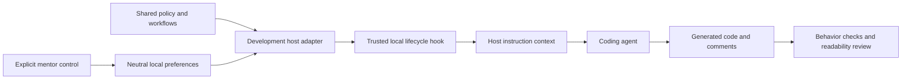

# Mentor local implementation plan

Status: Revised on 2026-10-06 for language/LLM neutrality and distribution last.
Implementation has not started.
Current local baseline: `main` at `42bc70c7d66c24ef54592a151c97488bbeb38a76`.
Use [DESIGN.md](DESIGN.md) for the intended experience, [TESTING.md](TESTING.md)
for observable criteria, and [ROADMAP.md](ROADMAP.md) for delivery status.

## Release goal and decisions

Make Mentor work well locally before distributing it. Its canonical policy,
workflows, preference contract, and evaluation criteria are coding-language- and
LLM-agnostic. Codex is the first development adapter; C# is the first fixture.
Neither defines the languages/models the core is designed to serve.

First prove generated code is readable, maintainable, appropriately commented,
and behaviorally correct. Then verify automatic policy delivery through an actual
local hook. Manual levels and interview/review coaching complete the first local
usable version. Each portion is implemented and tested immediately. Marketplace
discovery, packaging for others, and publication are the final phase.

| Decision | Agreed behavior |
| --- | --- |
| First user | The owner learning through real projects; neutral core, initial Codex development adapter and C# test case. |
| Neutrality | No model/vendor APIs, host hook schemas, or target-language defaults in canonical policy/workflows/state. Host specifics live in adapters; record actual tested combinations. |
| Participation | Guided offers a focused coding part; supported offers coding or reviewing; independent defaults to agent implementation with the learner directing and reviewing. Requests can change that allocation at any level. |
| Levels | Manual selection in the first usable release. Automatic progression follows. |
| Code standards | Descriptive names, understandable flow, appropriate boundaries, useful comments explaining intent/non-obvious rules, accurate documentation, and necessary verification at every level. |
| Coaching pause | Pause learning prompts while retaining code/documentation expectations and ordinary defect reporting. Native plugin disabling disables the whole package. |
| Preferences | Local per-project settings outside Git, remembered across sessions. |
| Readability checks | A policy hook, focused review of the actual diff, and existing project checks. The session hook delivers instructions; it cannot certify resulting code quality. |
| Verification | Test each slice immediately, reuse a small fixture with task variants and fresh contexts, and retain a reserved scenario. |
| Urgency | “I want it done as soon as possible so that i can start using it.” No fixed delivery date was given. |
| Distribution | Marketplace discovery, other-user packaging/installation, and public release happen after local product validation, in the final phase. |

Explore checked local host and packaging constraints; Plan examined learner
behavior and scope. Their parallel findings informed this plan. No implementation,
installation, trust changes, or publication were authorized by this planning task.

## Requirements

| ID | Requirement | Verification |
| --- | --- | --- |
| R01 | An actual local development hook supplies the shared policy to a fresh host session without pasting it or manually invoking a skill, including exercised lifecycle reloads. | T01–T03 |
| R02 | Readable, maintainable, appropriately commented code and documentation remain goals when coaching is paused. Respect project agreements and necessary checks. | T04, T05, T08 |
| R03 | Guided, supported, and independent change coaching intensity and participation defaults; none imposes a coding quota. | T06 |
| R04 | Explicit level and coaching selections apply to the current conversation and persist for that project. | T07, T08 |
| R05 | Distinct projects keep separate preferences. Shared worktrees of one repository share its preferences. | T07 |
| R06 | Demonstration/takeover requests receive direct help; repeated unproductive attempts receive useful escalation. | T05, T09 |
| R07 | Interview coaching establishes the next useful step through relevant questions and records remaining assumptions. | T10 |
| R08 | Review reads the actual diff and context, reports identified material defects with evidence, and distinguishes optional polish. | T11 |
| R09 | Each implementation portion includes its relevant checks and honest evidence before being called complete. | All applicable criteria |
| R10 | Shared resources, development adapters, and workflows work without the author's private toolkit, memory service, or machine paths. | T01, T02, T10, T11 |
| R11 | Runtime delivery, correctness, readability/comments, mentoring conduct, and human comprehension are separate outcomes. | T12 and every evidence report |
| R12 | Core behavior is language/LLM-neutral; compatibility claims identify tested language, model/provider, and host combinations. | T13 |
| R13 | Distribution/discovery requirements are evaluated in the final milestone after local behavior and quality evidence. | T14 |

## Core and development adapters

Proposed layout; these files do not exist yet:

```text
core/
  policy.md
  workflows/
    controls.md           # M02
    interview.md          # M03
    review.md             # M04
runtime/                  # neutral project-state/control helpers, M02
adapters/
  codex/
    hooks.json
    session_start.py
    skills/               # thin local invocation wrappers if needed
tests/
fixtures/expense-summary/ # initial C# task and independent checks
```

Keep one canonical core. It follows the actual project's language, conventions,
and checks, without model names, provider APIs, or language-specific style
defaults. Runtime helpers may use Python's standard library; that implementation
choice is separate from the learner's coding language.

The adapter translates host hook inputs, instruction roles, state-location
configuration, and workflow invocation into neutral core inputs. Do not duplicate
or specialize the core policy for each vendor. Hosts without a verified automatic
loading mechanism can be used for explicitly labeled policy experiments; do not
claim the always-on feature works on them.

M01 first tests policy-driven generated code, then the real local hook. The initial
Codex adapter uses a synchronous SessionStart command hook for startup/resume/clear/
compact. Resolve core resources from the development adapter's location rather
than the fixture working directory; quote paths with spaces. Emit supported
hook context, keep it concise, and use the host's normal hook review/trust flow.
Configure the development hook in a disposable workspace through a supported
local configuration. A plugin manifest, marketplace, or public installer is not
required. [Official hook configuration and delivery](https://learn.chatgpt.com/docs/hooks).



A direct policy experiment tests behavior. An actual host trace tests automatic
delivery. The core's generated code must meet the quality criteria in both.
Manual controls apply to the current conversation and persist project settings.
User instructions and project implementation agreements remain authoritative.

Final M08 packaging can wrap this core for supported hosts, add manifests,
marketplace/catalog entries, and other-user installation/update/removal flows.
Do not move those distribution requirements into M01–M04.

## Local preferences

Neutral storage contract: `<data-root>/projects/<project-id>/preferences.json`.
Core helpers receive the data root and project identity explicitly. The local
adapter uses `MENTOR_DATA_DIR` when configured, otherwise `<user-home>/.mentor`.
This keeps preferences outside Git and independent of a model/vendor or installed
plugin cache. A later host wrapper can map its own data directory to this contract;
shared settings across hosts require the same configured root. No vendor-specific
environment variable belongs in the core schema or policy.

Resolve project identity from the workspace directory supplied by the adapter:

1. Inside Git, use the canonical absolute Git common directory. A repository's
   subdirectories and linked worktrees resolve to the same identity.
2. Otherwise use the canonical workspace directory. For a non-Git project,
   start at its root; nested starting directories are distinct in this version.
3. Hash the canonical identity using SHA-256 for a stable filesystem-safe key.
   Different clones remain different local projects; do not key by remote URL.

Moving a repository can change its identity. Document reset/reselection as the
first-release recovery; automatic migration and shared learner accounts are later
scope. The local OS user is the learner identity for this release.

Minimal persisted shape:

```json
{
  "schema_version": 1,
  "level": "guided",
  "coaching_enabled": true
}
```

Validate the version, exact level enum, and boolean type. Missing records use
guided/coaching-on defaults and need not create a file until an explicit change.
Read errors, malformed/unsupported records, or unavailable data storage produce
a visible warning; retain the core code policy and use guided defaults. Preserve
unreadable/invalid records until an explicit reset. Failed writes must not claim
persistence; the requested change may still apply to the current conversation.

Share identity resolution and validation between the hook and control helper.
The adapter can include a concise resolved data location for control execution;
ordinary tool calls must not assume host-hook environment variables are present.
Control scripts receive that location explicitly or report it unavailable.
The control helper validates actions and updates existing valid settings through
an atomic replacement. Changing one preference preserves the other. First-release
concurrent writes use last-completed-write semantics; no cross-session merge claim.
Other already-open conversations refresh on an explicit control/status operation
or their next lifecycle hook, rather than receiving live broadcasts.

## Controls and interaction

These are intended neutral natural-language actions, exposed through a thin host
control wrapper when necessary, not claims about existing host slash commands.

| Request | Effect |
| --- | --- |
| Set guided / supported / independent | Change the active level and persist it for this project. |
| Show mentor status | Show level, coaching state, project scope, and persistence warnings; refresh from the local record. |
| Pause coaching / mentoring off | Persist coaching off; continue code standards, required checks, and defect reporting. |
| Resume coaching | Persist coaching on at the selected level. |
| Demonstrate / take over this part | Give direct help for the current task without changing the project's level. |
| More / less help with this part | Adjust assistance locally without recording an automatic level change. |
| Reset this project's preferences | Restore guided/coaching-on defaults for this project only. |

Guided offers a purposeful coding contribution and enough surrounding context.
When the learner accepts, pause for their attempt; on a demonstration/takeover
request, complete the part and explain the important flow. Supported offers coding
or reviewing; independent favors agent implementation plus learner decisions,
review, and verification. Explicit ownership requests can change these defaults.
Do not leave unaccepted placeholders or call an unfinished learner contribution
complete. Non-coding tasks and paused coaching have no compulsory exercise.

The core policy prompts proportionate interview/review coaching when relevant.
Supporting skills provide deeper workflows on request or when the task warrants
them. There is no compulsory full interview or quiz for every edit.

## Delivery and immediate verification

| Slice | Handoff | Required result |
| --- | --- | --- |
| M01 | [Readable-code core and local hook](handoffs/M01-readable-code-core.md) | Neutral policy, actual generated code/comments/docs, controlled baseline, initial fixture, and verified development hook delivery. |
| M02 | [Manual levels and preferences](handoffs/M02-manual-levels-and-preferences.md) | Explicit controls, project isolation, persistence, coaching pause, and level-specific participation. |
| M03 | [Interview coaching](handoffs/M03-interview-coaching.md) | Neutral requirements workflow with a thin development invocation adapter, tested against ambiguity and learner reasoning. |
| M04 | [Review coaching](handoffs/M04-review-coaching.md) | Neutral local-diff review workflow tested against a real defect plus optional polish. |

Implement and run each slice's applicable [criteria](TESTING.md#criteria) immediately.
Keep failures and pending checks in its handback. Do not mark a milestone verified
from a written test plan, policy-only simulation, or synthetic success alone.
M01 provides early local feedback; the first local usable version is complete
when M01–M04 satisfy their criteria. Actual hook testing is required in M01, even
though marketplace/distribution testing is deferred. The full runner is outside
this critical path.

Before copying adapted source, record its repository/version, license, and
required notices. Author original instructions when redistribution terms do not
permit copying. Source material is inspiration; packaged skills cannot depend on
private integrations. Update status/docs after each implemented slice.

## Later evidence and adaptation

Keep future observations separate from explicit preferences. A candidate local
`evidence.jsonl` entry records concept, task variant, observed behavior, assistance,
outcome, a specific evidence reference, and the reason for any proposed adjustment.
Store minimal observations outside public Git, with a way to inspect/reset them.
Do not store full conversations by default or infer mastery from passing tests.

Independently explaining or reviewing agent-written code can provide evidence;
the agent's answer itself cannot. Mark reasoning following a supplied answer or
hint as assisted. Independent self-correction is useful evidence. A candidate
threshold of three independent observations across at least two task variants
remains an unvalidated heuristic for a later experiment.

Adapt by concept, visibly and gradually, with manual locks and direct help
available. Reduced coaching and greater delegation are different from harder
tasks; automatic challenge selection requires its own design and evaluation.
After local M01–M04, M05 broadens language/provider coverage and isolated evaluation;
M06 tests adaptive evidence; M07 records real-project use and comprehension.
[M08 distribution](handoffs/M08-distribution.md) is the final milestone: manifests,
marketplace discovery, other-user installation/update/removal, and publication.
Do not advertise universal compatibility; publish a tested-support matrix.

## Definition of this planning change

Complete when the design, roadmap, local handoffs, final distribution boundary,
and test criteria agree; state
and failure behavior are specified; documentation links/formatting are checked;
and implementation/evaluation status remains truthful. Plugin execution and
learning results are pending implementation, not outcomes of this document.
