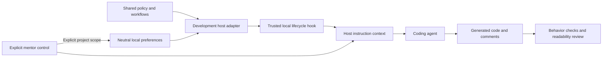

# Mentor local implementation plan

Status: Revised on 2026-10-06 for language/LLM neutrality, distribution last,
and M02's confirmed session-default controls and verification contracts.
M01 is implemented and locally verified; [results](evidence/M01.md) distinguish
code quality, simulated conduct, and actual host delivery. M02 is also implemented
and locally verified; [M02 results](evidence/M02.md) record controls, preferences,
native lifecycle/refresh and conduct/code evidence. M03–M08 remain planned.
M01 was implemented from planning revision `6e1efc2` on
`feat/m01-readable-code-core`.
Use [DESIGN.md](DESIGN.md) for the intended experience, [TESTING.md](TESTING.md)
for observable criteria, and [ROADMAP.md](ROADMAP.md) for delivery status.

## Release goal and decisions

Make Mentor work well locally before distributing it. Its canonical policy,
workflows, preference contract, and evaluation criteria are coding-language- and
LLM-agnostic. Codex is the first development adapter; C# is the first fixture.
Neither defines the languages/models the core is designed to serve.

First prove generated code is readable, maintainable, appropriately commented,
and behaviorally correct. Then verify automatic policy delivery through an actual
local hook. Manual levels and interview/review coaching complete the first local
usable version. Each portion is implemented and tested immediately. Marketplace
discovery, packaging for others, and publication are the final phase.

| Decision | Agreed behavior |
| --- | --- |
| First user | The owner learning through real projects; neutral core, initial Codex development adapter and C# test case. |
| Neutrality | No model/vendor APIs, host hook schemas, or target-language defaults in canonical policy/workflows/state. Host specifics live in adapters; record actual tested combinations. |
| Participation | Guided offers a focused coding part; supported offers coding or reviewing; independent defaults to agent implementation with the learner directing and reviewing. Requests can change that allocation at any level. |
| Levels | Manual selection in the first usable release. Automatic progression follows. |
| Code standards | Descriptive names, understandable flow, appropriate boundaries, useful comments explaining intent/non-obvious rules, accurate documentation, and necessary verification at every level. |
| Coaching pause | Pause learning prompts while retaining code/documentation expectations and ordinary defect reporting. Native plugin disabling disables the whole package. |
| Preferences | Controls change the current session by default. Explicit project-scope changes save local preferences outside Git for later sessions. |
| Readability checks | A policy hook, focused review of the actual diff, and existing project checks. The session hook delivers instructions; it cannot certify resulting code quality. |
| Verification | Test each slice immediately, reuse a small fixture with task variants and fresh contexts, and retain a reserved scenario. |
| Urgency | “I want it done as soon as possible so that i can start using it.” No fixed delivery date was given. |
| Distribution | Marketplace discovery, other-user packaging/installation, and public release happen after local product validation, in the final phase. |
| Optional tooling | M05 includes repository-owned Serena setup/configuration/docs and verification under a thin host adapter. Reuse a compatible existing MCP connection; provide opt-in setup when missing. Tool capability does not change mentee work, preferences or implementation ownership. |

Explore checked local host and packaging constraints; Plan examined learner
behavior and scope. Their parallel findings informed this plan. The planning
task did not authorize implementation or publication. The subsequent explicit M01
implementation request authorized its local code and development-hook verification;
distribution remains outside this slice.

## Requirements

| ID | Requirement | Verification |
| --- | --- | --- |
| R01 | An actual local development hook supplies the shared policy to a fresh host session without pasting it or manually invoking a skill, including exercised lifecycle reloads. | T01–T03 |
| R02 | Readable, maintainable, appropriately commented code and documentation remain goals when coaching is paused. Respect project agreements and necessary checks. | T04, T05, T08 |
| R03 | Guided, supported, and independent change coaching intensity and participation defaults; none imposes a coding quota. | T06 |
| R04 | Level and coaching selections apply to the current conversation by default. Only explicit project-scope changes persist; failed saves still apply locally with an unsaved warning. | T03, T07, T08 |
| R05 | Distinct projects keep separate preferences. Shared worktrees of one repository share its preferences. | T07 |
| R06 | Demonstration/takeover requests receive direct help; repeated unproductive attempts receive useful escalation. | T05, T09 |
| R07 | Interview coaching establishes the next useful step through relevant questions and records remaining assumptions. | T10 |
| R08 | Review reads the actual diff and context, reports identified material defects with evidence, and distinguishes optional polish. | T11 |
| R09 | Each implementation portion includes its relevant checks and honest evidence before being called complete. | All applicable criteria |
| R10 | Shared resources, development adapters, and workflows work without the author's private toolkit, memory service, or machine paths. | T01, T02, T10, T11 |
| R11 | Runtime delivery, correctness, readability/comments, mentoring conduct, and human comprehension are separate outcomes. | T12 and every evidence report |
| R12 | Core behavior is language/LLM-neutral; compatibility claims identify tested language, model/provider, and host combinations. | T13 |
| R13 | Distribution/discovery requirements are evaluated in the final milestone after local behavior and quality evidence. | T14 |

## Core and development adapters

Layout: M01 supplies the policy, development adapter, fixture, and contract checks.
M02 supplies the controls workflow and neutral preference helper. Interview and
review workflows remain M03/M04.

```text
core/
  policy.md
  workflows/
    controls.md           # M02
    interview.md          # M03
    review.md             # M04
runtime/                  # neutral project-state/control helpers, M02
  preferences.py
adapters/
  codex/
    development_config.py # prints hooks.json for a disposable workspace
    session_start.py
    control.py            # thin local tool wrapper, M02
    skills/               # later thin local invocation wrappers if needed
    serena/               # M05 planned setup/configuration/usage, not implemented
tests/
fixtures/expense-summary/ # initial C# task and independent checks
```

Keep one canonical core. It follows the actual project's language, conventions,
and checks, without model names, provider APIs, or language-specific style
defaults. Runtime helpers may use Python's standard library; that implementation
choice is separate from the learner's coding language.

The adapter translates host hook inputs, instruction roles, state-location
configuration, and workflow invocation into neutral core inputs. Do not duplicate
or specialize the core policy for each vendor. Hosts without a verified automatic
loading mechanism can be used for explicitly labeled policy experiments; do not
claim the always-on feature works on them.

M01 first tests policy-driven generated code, then the real local hook. The initial
Codex adapter uses a synchronous SessionStart command hook for startup/resume/clear/
compact. Resolve core resources from the development adapter's location rather
than the fixture working directory; quote paths with spaces. Emit supported
hook context, keep it concise, and use the host's normal hook review/trust flow.
Configure the development hook in a disposable workspace through a supported
local configuration. A plugin manifest, marketplace, or public installer is not
required. [Official hook configuration and delivery](https://learn.chatgpt.com/docs/hooks).



A direct policy experiment tests behavior. An actual host trace tests automatic
delivery. The core's generated code must meet the quality criteria in both.
Manual controls apply to the current conversation; only explicit project-scope
requests persist project settings.
User instructions and project implementation agreements remain authoritative.

Final M08 packaging can wrap this core for supported hosts, add manifests,
marketplace/catalog entries, and other-user installation/update/removal flows.
Do not move those distribution requirements into M01–M04.

### Hook and control delivery

M01 delivered only `core/policy.md`. The implemented M02 hook also delivers the
neutral controls workflow, saved settings, persistence warnings and pinned control
guidance. It distinguishes project defaults from retained session choices. Locate resources
relative to the adapter, independently of the learner's working directory. Supply
the controls instructions directly or a trusted resource location with enough
invocation guidance to use them without the author's private skills.

The adapter supplies the resolved workspace/project identity, data root, and
helper/interpreter locations needed for control execution. Ordinary tool calls
must not assume hook-only environment variables exist; pass these locations
explicitly through the thin wrapper. Use the same identity and validation helper
for hooks and controls, even when a tool starts in another directory. Keep host
input schemas, instruction roles, environment mapping, and quoting in the adapter.
Session-only controls need not write storage or create a preference record.

A preference read or storage failure must still deliver the valid code policy,
with a visible warning and fallback project defaults. Missing/invalid core policy
retains M01's visible adapter failure; it is not a successful policy load. Record
actual delivered policy, settings, and control guidance through the native runtime,
then exercise a control there. Handler JSON or a model acknowledgment alone does
not prove delivery or working controls. No custom host slash command is assumed.

## Local preferences

Neutral storage contract: `<data-root>/projects/<project-id>/preferences.json`.
Core helpers receive the data root and project identity explicitly. The local
adapter uses `MENTOR_DATA_DIR` when configured, otherwise `<user-home>/.mentor`.
This keeps preferences outside Git and independent of a model/vendor or installed
plugin cache. A later host wrapper can map its own data directory to this contract;
shared settings across hosts require the same configured root. Require an absolute
configured data root and carry its resolved location into control invocation;
invalid configuration warns and makes persistence unavailable without choosing
another storage location silently. No vendor-specific
environment variable belongs in the core schema or policy.

Resolve project identity from the workspace directory supplied by the adapter:

1. Inside Git, use the canonical absolute Git common directory. A repository's
   subdirectories and linked worktrees resolve to the same identity.
2. Otherwise use the canonical workspace directory. For a non-Git project,
   start at its root; nested starting directories are distinct in this version.
3. Hash the canonical identity using SHA-256 for a stable filesystem-safe key.
   Different clones remain different local projects; do not key by remote URL.

Distinguish a non-Git workspace from a failed Git lookup. If identity cannot be
resolved reliably, warn and keep persistence unavailable rather than accessing
another project's record. Canonicalization must handle symlinked paths consistently.

Moving a repository can change its identity. Document reset/reselection as the
first-release recovery; automatic migration and shared learner accounts are later
scope. The local OS user is the learner identity for this release.

Minimal persisted shape:

```json
{
  "schema_version": 1,
  "level": "guided",
  "coaching_enabled": true
}
```

Validate the version, exact level enum, and boolean type. Missing records use
guided/coaching-on project defaults. Do not create storage on reads, status, or
session-only changes; create a record only for an explicit project mutation.
Session overrides are separate from this minimal persisted schema.

### Preference precedence and lifetime

For each field, use a current session override when present; otherwise use the
latest loaded project setting, falling back to guided/on. Session choices are
retained in conversation context across resume/manual compaction. Hook context
labels stored settings as project defaults, so reloads do not replace explicit
session choices. Verify this behavior in the actual host; policy text alone is
not proof of retention.

| Operation | Current conversation | Saved project preferences |
| --- | --- | --- |
| Startup or clear | Load project defaults with no previous conversation overrides. | Read only; missing record defaults to guided/on. |
| Resume or manual compaction | Reload project defaults and retain session overrides. | Read only. |
| Unqualified level/pause/resume | Override only the requested field for this session. | No write. |
| Status or control refresh | Reload project defaults; retain session overrides and show effective/saved values separately when different. | Read only unless a project mutation was explicitly requested. |
| Successful project level/pause/resume | Apply the requested field and clear its session override; retain any override on the other field. | Atomically update only the requested field; preserve the other saved field. |
| Failed project level/pause/resume | Apply the requested field as an unsaved session override; retain the other field. | Report failure; do not claim saved success or silently repair an invalid record. |
| Explicit project reset | Apply guided/on and clear current overrides; if saving fails, retain those defaults as unsaved session overrides. | Restore guided/on for this project only, or report non-persistence. |

Demonstration/takeover, task-specific help, and implementation ownership are
separate from persisted level/coaching fields. A task-only help adjustment ends
with that task; unqualified level/coaching changes last for the conversation.
An explicit request to use project preferences again clears the relevant session
override without writing storage.

Other open conversations receive no live broadcast. They refresh project defaults
on an explicit status/control operation or their next lifecycle hook, preserving
their own overrides. For example, session A's explicit project-level change becomes
effective in session B after status if B has no level override. B's own level
override still wins and status reports both values. Clear starts a new conversation
without these overrides. Existing project ownership agreements remain authoritative.

### Failure and recovery

Read errors, malformed/unsupported records, or unavailable storage warn visibly.
Use guided/on as fallback project defaults while preserving any session overrides
and the valid code policy. Keep unreadable/invalid records intact until explicit
project reset. Ordinary project mutations refuse to overwrite these records,
apply the requested field locally, and explain that reset is needed before saving.
Session-only controls remain available without working storage.

The control helper validates actions and uses atomic replacement for successful
project writes. Changing one field preserves the other saved field, not a temporary
override from the conversation. A failed write leaves the prior record intact and
returns a persistence failure separately from the requested conversation change.
Report requested/effective values, saved values when readable, and the failure;
never claim a reset recovered storage unless that operation succeeded. First-release
concurrent writes use last-completed-write semantics; no cross-session merge claim.

## Controls and interaction

These are intended neutral natural-language actions, exposed through a thin host
control wrapper when necessary, not claims about existing host slash commands.
Unqualified requests change only the session. Persist only when the learner
explicitly asks for project scope, such as "use independent for this project" or
"save coaching off as this project's default". Do not ask a persistence question
for every session control; confirm the scope and actual result when responding.

| Request | Effect |
| --- | --- |
| Set guided / supported / independent | Change the active level for this session. |
| Show mentor status | Refresh project defaults; show effective level/coaching, session overrides, saved values or fallback state, project scope, and persistence warnings. |
| Pause coaching / mentoring off | Pause coaching for this session; continue code standards, required checks, and defect reporting. |
| Resume coaching | Resume coaching for this session at its effective level. |
| Set a level or coaching state explicitly for this project | Apply now and save only the requested field; report verified persistence or an unsaved session change. |
| Use project preferences in this session | Clear the requested session overrides and use refreshed project defaults without writing storage. |
| Demonstrate / take over this part | Give direct help for the current task without changing the project's level. |
| More / less help with this part | Adjust assistance locally without recording an automatic level change. |
| Reset this project's preferences | Restore guided/on for this project and clear current session overrides; report any persistence failure. Other sessions keep their own overrides. |

Guided offers a purposeful coding contribution and enough surrounding context.
When the learner accepts, pause for their attempt; on a demonstration/takeover
request, complete the part and explain the important flow. Supported offers coding
or reviewing; independent favors agent implementation plus learner decisions,
review, and verification. Explicit ownership requests can change these defaults.
Do not leave unaccepted placeholders or call an unfinished learner contribution
complete. Non-coding tasks and paused coaching have no compulsory exercise.

The core policy prompts proportionate interview/review coaching when relevant.
Supporting skills provide deeper workflows on request or when the task warrants
them. There is no compulsory full interview or quiz for every edit.

## Delivery and immediate verification

| Slice | Handoff | Required result |
| --- | --- | --- |
| M01 | [Readable-code core and local hook](handoffs/M01-readable-code-core.md) | Neutral policy, actual generated code/comments/docs, controlled baseline, initial fixture, and verified development hook delivery. |
| M02 | [Manual levels and preferences](handoffs/M02-manual-levels-and-preferences.md) | Explicit controls, project isolation, persistence, coaching pause, and level-specific participation. |
| M03 | [Interview coaching](handoffs/M03-interview-coaching.md) | Neutral requirements workflow with a thin development invocation adapter, tested against ambiguity and learner reasoning. |
| M04 | [Review coaching](handoffs/M04-review-coaching.md) | Neutral local-diff review workflow tested against a real defect plus optional polish. |

Implement and run each slice's applicable [criteria](TESTING.md#criteria) immediately.
Keep failures and pending checks in its handback. Do not mark a milestone verified
from a written test plan, policy-only simulation, or synthetic success alone.
M01 provides early local feedback; the first local usable version is complete
when M01–M04 satisfy their criteria. Actual hook testing is required in M01, even
though marketplace/distribution testing is deferred. The full runner is outside
this critical path.

Before copying adapted source, record its repository/version, license, and
required notices. Author original instructions when redistribution terms do not
permit copying. Source material is inspiration; packaged skills cannot depend on
private integrations. Update status/docs after each implemented slice.

## Later evidence and adaptation

Keep future observations separate from explicit preferences. A candidate local
`evidence.jsonl` entry records concept, task variant, observed behavior, assistance,
outcome, a specific evidence reference, and the reason for any proposed adjustment.
Store minimal observations outside public Git, with a way to inspect/reset them.
Do not store full conversations by default or infer mastery from passing tests.

Independently explaining or reviewing agent-written code can provide evidence;
the agent's answer itself cannot. Mark reasoning following a supplied answer or
hint as assisted. Independent self-correction is useful evidence. A candidate
threshold of three independent observations across at least two task variants
remains an unvalidated heuristic for a later experiment.

Adapt by concept, visibly and gradually, with manual locks and direct help
available. Reduced coaching and greater delegation are different from harder
tasks; automatic challenge selection requires its own design and evaluation.
After local M01–M04, [M05](handoffs/M05-portability-and-tooling.md) broadens
language/provider coverage, adds optional Serena tooling and isolated evaluation;
M06 tests adaptive evidence; M07 records real-project use and comprehension.
[M08 distribution](handoffs/M08-distribution.md) is the final milestone: manifests,
marketplace discovery, other-user installation/update/removal, and publication.
Do not advertise universal compatibility; publish a tested-support matrix.

## Definition of this planning change

Complete when the design, roadmap, local handoffs, final distribution boundary,
and test criteria agree; state
and failure behavior are specified; documentation links/formatting are checked;
and implementation/evaluation status remains truthful. Those planning checks did
not establish runtime delivery or learning. Subsequent M01 delivery/code results
are recorded in [the evidence report](evidence/M01.md); human learning remains
unobserved.
