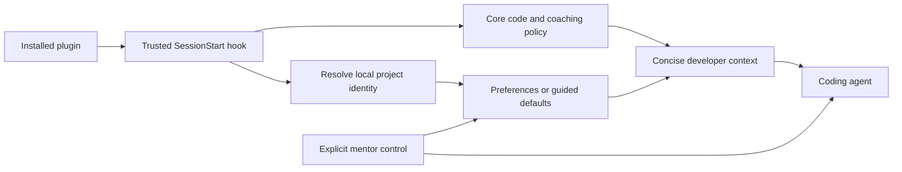

# Mentor first usable release

Status: Confirmed planning scope on 2026-10-06. Implementation has not started.
Local planning baseline: `main` at `2e422c0035301ab5e9504bff0056d73702c83c40`.
Use [DESIGN.md](DESIGN.md) for the intended experience, [TESTING.md](TESTING.md)
for observable criteria, and [ROADMAP.md](ROADMAP.md) for delivery status.

## Release goal and decisions

Make Mentor usable by the owner on real projects as soon as practical. Installing
and trusting the plugin should establish readable-code expectations automatically.
The learner selects guided, supported, or independent coaching and can pause it
without dropping code standards. The first usable release includes interview
and review coaching. Each portion is implemented and tested immediately.

| Decision | Agreed behavior |
| --- | --- |
| First user | The owner learning through real project work; Codex first, C# examples. |
| Participation | Guided offers a focused coding part; supported offers coding or reviewing; independent defaults to agent implementation with the learner directing and reviewing. Requests can change that allocation at any level. |
| Levels | Manual selection in the first usable release. Automatic progression follows. |
| Code standards | Descriptive domain names, understandable flow, appropriate boundaries, accurate useful documentation, and necessary verification at every level. |
| Coaching pause | Pause learning prompts while retaining code/documentation expectations and ordinary defect reporting. Native plugin disabling disables the whole package. |
| Preferences | Local per-project settings outside Git, remembered across sessions. |
| Readability checks | A policy hook, focused review of the actual diff, and existing project checks. The session hook delivers instructions; it cannot certify resulting code quality. |
| Verification | Test each slice immediately, reuse a small fixture with task variants and fresh contexts, and retain a reserved scenario. |
| Urgency | “I want it done as soon as possible so that i can start using it.” No fixed delivery date was given. |

Explore checked local host and packaging constraints; Plan examined learner
behavior and scope. Their parallel findings informed this plan. No implementation,
installation, trust changes, or publication were authorized by this planning task.

## Requirements

| ID | Requirement | Verification |
| --- | --- | --- |
| R01 | An installed, enabled, trusted plugin supplies its core policy without a manual skill invocation, including exercised lifecycle reloads. | T01–T03 |
| R02 | Readable-code and documentation expectations remain active when coaching is paused. Respect explicit project agreements and necessary checks. | T04, T05, T08 |
| R03 | Guided, supported, and independent change coaching intensity and participation defaults; none imposes a coding quota. | T06 |
| R04 | Explicit level and coaching selections apply to the current conversation and persist for that project. | T07, T08 |
| R05 | Distinct projects keep separate preferences. Shared worktrees of one repository share its preferences. | T07 |
| R06 | Demonstration/takeover requests receive direct help; repeated unproductive attempts receive useful escalation. | T05, T09 |
| R07 | Interview coaching establishes the next useful step through relevant questions and records remaining assumptions. | T10 |
| R08 | Review reads the actual diff and context, reports identified material defects with evidence, and distinguishes optional polish. | T11 |
| R09 | Each implementation portion includes its relevant checks and honest evidence before being called complete. | All applicable criteria |
| R10 | Package resources and adapted workflows work without the author's private toolkit, memory service, or machine paths. | T01, T02, T10, T11 |
| R11 | Runtime delivery, correctness, readability, mentoring conduct, and human comprehension are separate outcomes. | T12 and every evidence report |

## Package and runtime

Proposed layout; these files do not exist yet:

```text
.agents/plugins/marketplace.json
plugins/mentor/
  plugin.json
  policy/core.md
  hooks/hooks.json
  hooks/session_start.py
  scripts/                 # shared state/control helpers added in M02
  skills/
    mentor/SKILL.md        # manual controls added in M02
    mentor-interview/SKILL.md
    mentor-review/SKILL.md
tests/                    # executable hook/state contract checks
fixtures/expense-summary/ # small reusable C# project and scenarios
```

Use the portable root manifest and `extensions.com.openai` for hook configuration.
The repo marketplace exposes local source `./plugins/mentor`. Resolve resources
from the installed package, quote paths containing spaces, and document cache
refresh/restart behavior. Do not assume editing the checkout changes the installed
copy. Use Python's standard library for hook/state helpers; record tested versions.

The synchronous `SessionStart` command hook handles `startup`, `resume`, `clear`,
and `compact`. It loads the canonical policy plus the effective preferences and
emits supported JSON `hookSpecificOutput.additionalContext`. Keep context concise;
do not inject the entire design, interview transcript, or evidence history.
Installation/enabling and hook trust are separate. Use the host's review flow
for the exact hook definition. [Official packaging](https://developers.openai.com/plugins/build/plugins),
[hook input/output and trust](https://learn.chatgpt.com/docs/hooks).



The hook supplies defaults. The supporting control workflow applies changes to
the current conversation and persists explicit project settings. Existing user
instructions and project implementation agreements remain authoritative.

## Local preferences

Proposed storage: `PLUGIN_DATA/projects/<project-id>/preferences.json`. Codex
supplies `PLUGIN_DATA` to plugin hook commands as a writable data directory;
per-project organization is Mentor's own design. Do not write into the installed
package. [Plugin data environment](https://developers.openai.com/plugins/build/plugins).

Resolve project identity from the event's `cwd`:

1. Inside Git, use the canonical absolute Git common directory. A repository's
   subdirectories and linked worktrees resolve to the same identity.
2. Otherwise use the canonical workspace directory. For a non-Git project,
   start at its root; nested starting directories are distinct in this version.
3. Hash the canonical identity using SHA-256 for a stable filesystem-safe key.
   Different clones remain different local projects; do not key by remote URL.

Moving a repository can change its identity. Document reset/reselection as the
first-release recovery; automatic migration and shared learner accounts are later
scope. The local OS user is the learner identity for this release.

Minimal persisted shape:

```json
{
  "schema_version": 1,
  "level": "guided",
  "coaching_enabled": true
}
```

Validate the version, exact level enum, and boolean type. Missing records use
guided/coaching-on defaults and need not create a file until an explicit change.
Read errors, malformed/unsupported records, or unavailable data storage produce
a visible warning; retain the core code policy and use guided defaults. Preserve
unreadable/invalid records until an explicit reset. Failed writes must not claim
persistence; the requested change may still apply to the current conversation.

Share identity resolution and validation between the hook and control helper.
The hook can include a concise resolved data location for control execution;
ordinary tool calls must not assume the hook-only environment is present.
Control scripts receive that trusted location explicitly or report it unavailable.
The control helper validates actions and updates existing valid settings through
an atomic replacement. Changing one preference preserves the other. First-release
concurrent writes use last-completed-write semantics; no cross-session merge claim.
Other already-open conversations refresh on an explicit control/status operation
or their next lifecycle hook, rather than receiving live broadcasts.

## Controls and interaction

These are intended natural-language actions exposed by the bundled `mentor`
skill, not claims about existing host slash commands.

| Request | Effect |
| --- | --- |
| Set guided / supported / independent | Change the active level and persist it for this project. |
| Show mentor status | Show level, coaching state, project scope, and persistence warnings; refresh from the local record. |
| Pause coaching / mentoring off | Persist coaching off; continue code standards, required checks, and defect reporting. |
| Resume coaching | Persist coaching on at the selected level. |
| Demonstrate / take over this part | Give direct help for the current task without changing the project's level. |
| More / less help with this part | Adjust assistance locally without recording an automatic level change. |
| Reset this project's preferences | Restore guided/coaching-on defaults for this project only. |

Guided offers a purposeful coding contribution and enough surrounding context.
When the learner accepts, pause for their attempt; on a demonstration/takeover
request, complete the part and explain the important flow. Supported offers coding
or reviewing; independent favors agent implementation plus learner decisions,
review, and verification. Explicit ownership requests can change these defaults.
Do not leave unaccepted placeholders or call an unfinished learner contribution
complete. Non-coding tasks and paused coaching have no compulsory exercise.

The core policy prompts proportionate interview/review coaching when relevant.
Supporting skills provide deeper workflows on request or when the task warrants
them. There is no compulsory full interview or quiz for every edit.

## Delivery and immediate verification

| Slice | Handoff | Required result |
| --- | --- | --- |
| M01 | [Hook and code foundation](handoffs/M01-guided-plugin-foundation.md) | Installable guided default, actual hook delivery, original code/coaching policy, initial fixture and immediate contract/interaction checks. |
| M02 | [Manual levels and preferences](handoffs/M02-manual-levels-and-preferences.md) | Explicit controls, project isolation, persistence, coaching pause, and level-specific participation. |
| M03 | [Interview coaching](handoffs/M03-interview-coaching.md) | Portable learning-focused requirements workflow tested against ambiguity and learner reasoning. |
| M04 | [Review coaching](handoffs/M04-review-coaching.md) | Local-diff review workflow tested against a real defect plus optional polish. |

Implement and run each slice's applicable [criteria](TESTING.md#criteria) immediately.
Keep failures and pending checks in its handback. Do not mark a milestone verified
from a written test plan, policy-only simulation, or synthetic success alone.
M01 can provide early use feedback; the first usable release is complete after
M01–M04 meet their criteria. The full scenario runner is not on that critical path.

Before copying adapted source, record its repository/version, license, and
required notices. Author original instructions when redistribution terms do not
permit copying. Source material is inspiration; packaged skills cannot depend on
private integrations. Update status/docs after each implemented slice.

## Later evidence and adaptation

Keep future observations separate from explicit preferences. A candidate local
`evidence.jsonl` entry records concept, task variant, observed behavior, assistance,
outcome, a specific evidence reference, and the reason for any proposed adjustment.
Store minimal observations outside public Git, with a way to inspect/reset them.
Do not store full conversations by default or infer mastery from passing tests.

Independently explaining or reviewing agent-written code can provide evidence;
the agent's answer itself cannot. Mark reasoning following a supplied answer or
hint as assisted. Independent self-correction is useful evidence. A candidate
threshold of three independent observations across at least two task variants
remains an unvalidated heuristic for a later experiment.

Adapt by concept, visibly and gradually, with manual locks and direct help
available. Reduced coaching and greater delegation are different from harder
tasks; automatic challenge selection requires its own design and evaluation.
The full isolated actor/observer runner, baseline comparisons, human pilot, other
hosts, and public release receive later handoffs.

## Definition of this planning change

Complete when the design, roadmap, four handoffs, and test criteria agree; state
and failure behavior are specified; documentation links/formatting are checked;
and implementation/evaluation status remains truthful. Plugin execution and
learning results are pending implementation, not outcomes of this document.
