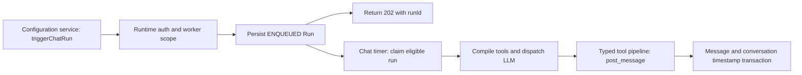

# Stafr backend: one queued-chat flow

Inspected existing source on 2026-10-07 at repository HEAD
`5514454883d96a007a83b150898885c1bb6a38b5`, using the current source contents.
Paths below are relative to the external Crew Workforce repository. This is
ordinary source explanation: no PR, diff, quiz or special walkthrough invocation
is required. It is not a full backend audit or evidence of human understanding.

The configuration service provides the dashboard and sends an authenticated chat
request. The runtime service accepts and persists that request, then executes the
worker asynchronously. Shared Prisma models live in `packages/database/`; the
render service is separate from this inspected chat path.

1. `agent-configuration-service/src/lib/runtime/client.ts:318`, `triggerChatRun`,
   validates input and checks shared workspace membership. It obtains service
   configuration, mints an identity token at line 351 and POSTs to
   `/agents/:workerId/run?queue=true` with internal-secret and identity headers.
   The queue response is parsed for runId at line 416. Transport failures map to
   RUNTIME_UNREACHABLE; malformed response bodies to RUNTIME_PROTOCOL_VIOLATION.
2. `agent-runtime-service/apps/api/src/app.ts:128` registers the route behind
   internal-secret then identity-token middleware. The handler in
   `src/routes/runs.ts:278` reads the verified identity, never a body workspaceId.
   It scopes worker lookup through `worker.team.workspaceId` at line 296; an absent
   or cross-workspace worker produces the same 404. Run context and trigger input
   are constructed, then a Run is inserted as ENQUEUED at line 359. Insert failure
   returns RUN_INSERT_FAILED. Queue mode returns HTTP 202 and runId at line 408;
   that response is acceptance, not the worker's eventual answer.
3. `src/cron/in-process-timer.ts`, `startInProcessCronTimers`, launches eligible
   CHAT executors through a default one-second timer; a general tick also exists.
   CHAT_TICK_INTERVAL_MS can disable/change the fast timer. This source is more
   specific than older documents that only describe external cron scheduling.
4. `src/dispatcher/run-executor.ts:387` claims the run with claimRun. It compiles
   tools at line 473, loads conversation context, builds the prompt at line 557,
   and calls dispatchLLMCall with the compiled toolset/context at line 596.
   Claiming, cancellation, persisted status and terminal behavior have additional
   branches; their live concurrency/recovery semantics were not exercised here.
5. `src/tools/compile.ts:362` routes AI-SDK tool execution through dispatchToolCall.
   `src/dispatch/tool.ts` composes authentication, approval, audit, tool-call-event,
   credentials and execution. The tool-call-event stage is present in current code
   and absent from some older overview descriptions. This ordering determines
   which work is authorized, audited and visible before actual tool execution.
6. `src/tools/adapters/universal.ts:303`, executePostMessage, validates the input,
   checks conversation/workspace/worker participation, and verifies a reply target
   belongs to that conversation. It calls postWorkerMessage at line 436.
   `src/runtime/conversation-message.ts:89` inserts the worker-authored Message and
   updates Conversation.lastMessageAt in one Prisma transaction. The executor also
   has a silent-completion/failure message guard. Browser stream/render behavior
   after this database write was not inspected or exercised in this slice.

Two existing suites, `src/__tests__/runs.test.ts` and
`src/__tests__/identity-token.test.ts`, pass 15 tests in a disposable copy. The
route suite mocks Prisma; these checks support tested auth/scoping/request behavior,
not actual Postgres transactions or inference. No backend was started and no
credentials or user data were used. The next useful inspection would connect the
persisted Message to the configuration service's inbox stream and UI rendering.
